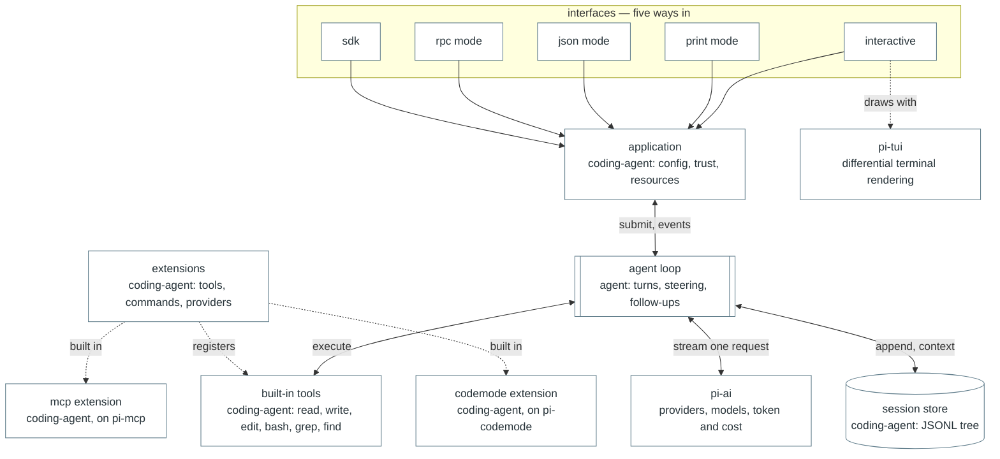
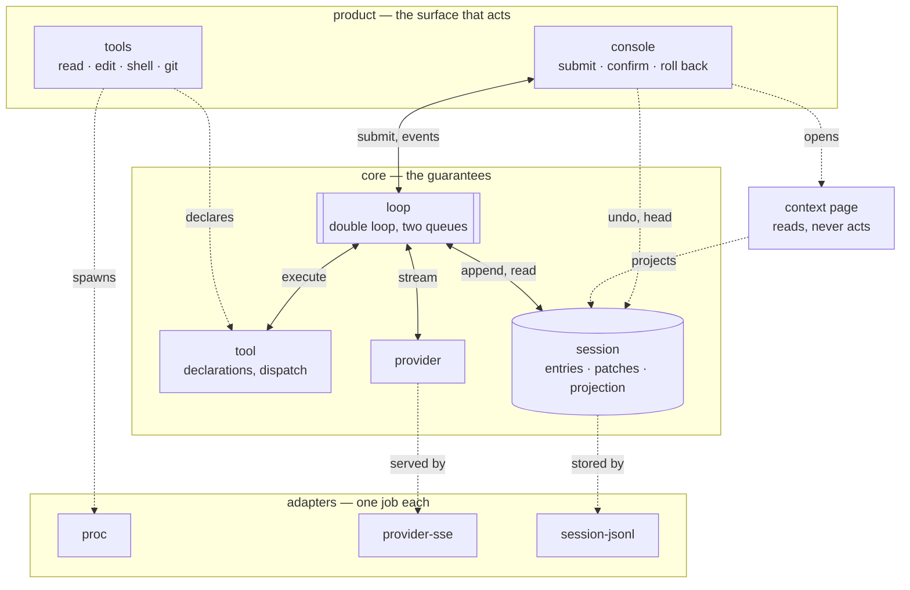

# PEARL

**P**i · **E**macs · **A**gent · **R**evertible · **L**isp

> A coding agent inside Emacs: Pi's loop, the editor's hands, and edits you take
> back with `C-/`.

PEARL's control flow is [Pi](https://github.com/earendil-works/pi)'s agent loop
— a small, model-agnostic loop that calls tools and feeds the results back. Everything the
loop touches is Emacs: buffers carry the context, `undo` carries the safety net,
and the editor's own vocabulary carries what the agent reports.

No Node process, no provider matrix, no plugin registry. One loop, one console,
a handful of tools.

What works today, and what comes next, is in [docs/roadmap.md](docs/roadmap.md).

## The promise

> Change a file through PEARL, press `C-/`, and the buffer is as if the agent
> had not touched it. The saved file follows your next save; to take a whole
> turn back on disk, the console's rollback restores the files themselves.

Three consequences, and they are the whole product:

- **No per-hunk approval.** Edits apply as they are planned. Approving every
  change taxes every correct edit to guard against a failure that undo already
  covers.
- **Every change is reported as it lands.** Nothing disappears quietly into the
  tree; the console is the record of what happened, and a session you close is
  one you can reopen where it stopped.
- **The undo is the one you already use.** A tool call is one `undo` step in the
  buffer it edited, not a separate history with its own commands.

## What PEARL is, and is not

It is an agent inside your editor, with your buffers as its context, small
enough to read: one loop, one console, tools you can count. It is not a terminal
agent with an Emacs front end, and not a platform — no plugin registry, no MCP.

## Installing

PEARL is not on MELPA yet; what will be published is [the
recipe](docs/releasing.md#submitting-to-melpa), and
[docs/releasing.md](docs/releasing.md) is the path from a checkout to a tag
and a pull request. Until then a checkout on `load-path` is the install:

```elisp
;; straight.el
(straight-use-package
 '(pearl :type git :host github :repo "OverbearingPearl/pearl"))

;; or a clone you keep yourself
(use-package pearl
  :load-path "~/projects/pearl"
  :commands pearl)
```

`M-x pearl` asks for a project root and opens the console there; it is the
only command you call, and it refuses to start without `git` on the path,
because a turn it cannot take back is a turn it will not run.

### Point it at an endpoint

PEARL speaks one protocol: the OpenAI-compatible streaming
`chat/completions` API. An endpoint that serves it works by changing the
base URL; one that serves something else is not supported
([ADR 7](docs/decisions/0007-why-one-provider-interface-and-not-one-adapter-per-api.md)).
DeepSeek, which is the endpoint the release run uses:

```elisp
(use-package pearl
  :commands pearl
  :custom
  (pearl-provider-sse-base-url "https://api.deepseek.com/v1")
  (pearl-console-models '("deepseek-flash" "deepseek-v4-pro"))
  (pearl-console-model-default "deepseek-flash"))
```

`pearl-provider-sse-base-url` is the endpoint's `/v1` prefix and not the
whole URL: `/chat/completions` is appended to it. `pearl-console-models` is
the list `C-c C-m` offers, and `pearl-console-model-default` is what a
console starts with; nil there asks once per console and remembers the
answer in the buffer.

The key is never a variable. It is read when a request is made, in this
order: `auth-source` for the host in the base URL, `PEARL_API_KEY` in the
environment, and one prompt that is remembered for the session
([ADR 17](docs/decisions/0017-why-the-api-key-is-resolved-at-use-not-stored.md)).
The host is the URL's, so the `authinfo` machine has to be that host exactly;
for the setting above it is `api.deepseek.com`:

```
machine api.deepseek.com password sk-...
```

`PEARL_API_KEY` is the same key for a start with no prompt to answer — a
container, CI, `env`-wrapped Emacs — and has to be exported before the first
request, because the answer is kept for the console's lifetime:

```sh
PEARL_API_KEY=sk-... emacs
```

`auth-source` is asked first, so an `authinfo` entry wins over the variable.
Export it in the shell rather than `setenv` it in `init.el`, for the reason
ADR 17 gives: the key has no path into a file you version.

### Keys in the console

| key | what it does |
| --- | --- |
| `RET` | send the line at point; while a run is in flight it steers instead |
| `TAB` | fold or unfold the turn at point; a folded turn is drawn as a marker |
| `C-c C-k` | stop the run, keeping the tool results it already has |
| `C-c C-m` | pick the model for this console, remembered for the session |
| `C-c C-r` | take the last turn back on disk |
| `C-c C-t` | draw every turn recorded under the project |
| `C-c C-u` | take back the turn at point, whichever session wrote it |
| `C-c C-o` | move the timeline to the turn at point, naming what stays written |
| `C-c C-c` | summarise the oldest turns and carry on from the summary |
| `C-c C-p` | show what the model is told: the prompt, the messages the next request carries, each priced in tokens |
| `C-c C-s` | show another session under the same project |
| `C-/` | undo an edit the agent made, in the buffer it made it in |

### The settings

```elisp
(setq pearl-app-user-instructions-file
      (locate-user-emacs-file "pearl/AGENTS.md")
      pearl-app-context-window        ; nil: compact only when asked
      200000
      pearl-app-keep-tokens           ; how much tail stays verbatim
      20000)
```

`pearl-app-provider` is the seam for a client of your own; nil, the default,
builds the SSE one. The transport's own limits are the
`pearl-provider-sse-*` timeouts, byte limit and retry count, each with a
default for an endpoint that is somebody else's.

`pearl-app-context-window` is the only setting that spends a model call
without being asked: when the projection outgrows it, the turn that ends
compacts and carries on from the summary. Nil is the default, because a
threshold nobody set must not buy a call nobody asked for.

The project's instructions are `AGENTS.md` at the root you open, and yours
are the file above, if either exists. Why the prompt is three sections with
one owner each, and why there is no function to append to, is
[ADR 21](docs/decisions/0021-why-the-prompt-has-one-mechanism-and-not-a-seam-beside-it.md).

## Two architectures, side by side

Two high-level pictures, each read top to bottom: Pi's interfaces over its
product over its loop, PEARL's layers and the one turn that crosses them. Pi comes
first because its loop is the machinery PEARL took; the differences are argued
and priced in [docs/decisions/](docs/decisions/).

### Pi

Read top to bottom: five interfaces over one coding agent, one agent loop under
it, and the model API under that. A folder is a package, and each node says
which one it comes from: `coding-agent` is the application and the tools and
store it owns, `agent` is the loop, `ai` is the providers and their accounting,
`tui` is the renderer the interactive mode draws with, and `mcp` and `codemode`
are extensions built on packages of their own.



### PEARL

Read it as one turn, taken again and again: the console submits, the loop asks
the provider, runs what comes back, appends it to the record, and reads the
record to build the next request. Three bands hold the layers — the product
acts, the core holds the guarantees, the adapters touch the world — and the two
surfaces the user meets are drawn apart on purpose: the console sits in the
band it belongs to, and the context page stands outside all three, because it
is not a layer but a reader of one, looking at the record and never writing.



Ten modules answer questions the turn does not ask, so they are named here
rather than drawn: `app` is the composition root, `delegate` opens a child
session, `review` puts a finished turn's findings in `next-error` and `xref`,
`undo` keeps change groups and snapshots, `tree` writes a snapshot file,
`prompt` and `compaction` build the preamble and the one summary that replaces
the turns it covers, and the core's `turn`, `contract` and `event` are the
shapes and streams every path above passes through.
[docs/architecture.md](docs/architecture.md) lists all of them, layer by
layer.

### Legend

Shape and line style mean the same thing in both pictures.

| mark | meaning |
| --- | --- |
|  | a module, or a component of one (`["…"]`) |
|  | a store: in Pi a file, in PEARL the record the core owns (`[("…")]`) |
|  | a control structure, not a module: the loop that queues (`[["…"]]`) |
|  | a call in one direction: the tail asks, and what comes back is not a value the tail reads (`-->`) |
|  | one call, both directions: the tail asks and the head hands something back in the same step. Drawn once, because two arrows would put a two-node cycle in the graph, and a layout engine breaks a cycle by reversing an edge, which is how an arrow that means "submit" ends up drawn pointing the other way (`<-->`) |
|  | a hand-off, not a request: the tail gives the head something and does not wait for a value — a page opened, a tool registered into the registry, a command spawned, an entry written — or a relation that is structural rather than a call (`-.->`) |

The bracket in each row is the Mermaid spelling, so the legend and both
figures agree on one vocabulary. A band is a layer: PEARL's picture draws the
three of
[ADR 12](docs/decisions/0012-layer-rules-are-checked-not-documented.md)'s four
rows that stack — product, core, adapters — and in Pi's picture the band is the
boundary between interfaces, the product, the loop and its dependencies. The
fourth row, `page`, has no band because it is not a floor: it is the rule that
a surface which reads the record may not require the one that writes it, and
the context page is drawn inside no band at all — outside every box is the only
place a frame does not claim it is a member
([ADR 37](docs/decisions/0037-why-a-page-projects-the-record-and-only-the-console-acts.md)).
A cylinder is a store the core owns — in Pi a file under the session store, in
PEARL the record itself, which the core owns and an adapter is the only thing
that writes
([ADR 3](docs/decisions/0003-why-the-session-lives-in-the-core.md)).

## Relationship to Pi

PEARL translates Pi's **loop** and builds a different product around it.

The machinery is Pi's, copied rather than redesigned: the double loop, the two
message channels, the event taxonomy, the tool protocol, and the behaviours in
[docs/decisions/0008-what-we-take-from-pi-verbatim.md](docs/decisions/0008-what-we-take-from-pi-verbatim.md).
What differs is where state lives, how undo works, how extensions attach, and how
many providers exist — one record each in [docs/decisions/](docs/decisions/),
with its price.

It is not a fork: no Pi code is vendored, and the two are free to diverge. Pi is
MIT-licensed, originally created by Mario Zechner and now maintained under
`earendil-works/pi`; PEARL is MIT too.

## Reading on

| Document | Answers |
| --- | --- |
| [docs/decisions/](docs/decisions/) | one record per decision: what PEARL does differently from Pi, what it costs, and what would overturn it |
| [docs/architecture.md](docs/architecture.md) | how the parts fit: two rings, four layers, and the rules each one is held to |
| [docs/glossary.md](docs/glossary.md) | one word, one meaning |
| [docs/roadmap.md](docs/roadmap.md) | what exists today, and the order the rest arrives in |
| [docs/releasing.md](docs/releasing.md) | what a release owes, and how the package reaches MELPA |

## Development

Layout: `pearl.el` is the only `.el` at the repository root, business modules
live in `lisp/`, tests in `test/`, design notes in `docs/`, decisions in
`docs/decisions/`. The check suite in `ci/` is a subtree of
[ci-elisp](https://github.com/OverbearingPearl/ci-elisp) and is not edited here;
this project's settings for it are in `config/ci.el`. `vendor/` holds the one
third-party file the tests need, and nothing else.

```sh
make lint    # checkdoc, package-lint, byte-compile, format, headers, layering, ADR shape
make test    # ERT over test/*.el
make size    # the lines each module costs, and the runs written twice
PEARL_PERF_SCALE=2 make test   # on a loaded machine: relax the two latency budgets
scripts/adr new "Title"   # the only supported way to add a decision record
```

A test is a story, not a case: it is written in `ert-gwt`'s Given-When-Then
form and it comes before the module it exercises. `make test` is therefore
allowed to be red while a stage is being built; `make lint` is not. The rules
an agent working in this repository follows are in [AGENTS.md](AGENTS.md).

`make lint` is byte-for-byte what CI runs, so a green local run means a green
`lint` job. The check suite and pipeline are described in
[`ci/README.md`](ci/README.md), which ships with the subtree.

## License

MIT. See [`LICENSE`](LICENSE); the copyright holder is OverbearingPearl.
