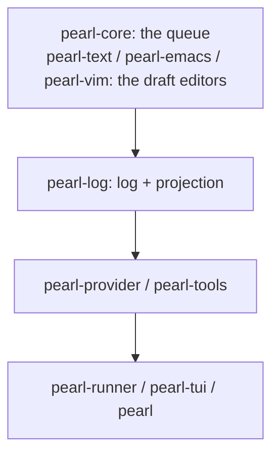
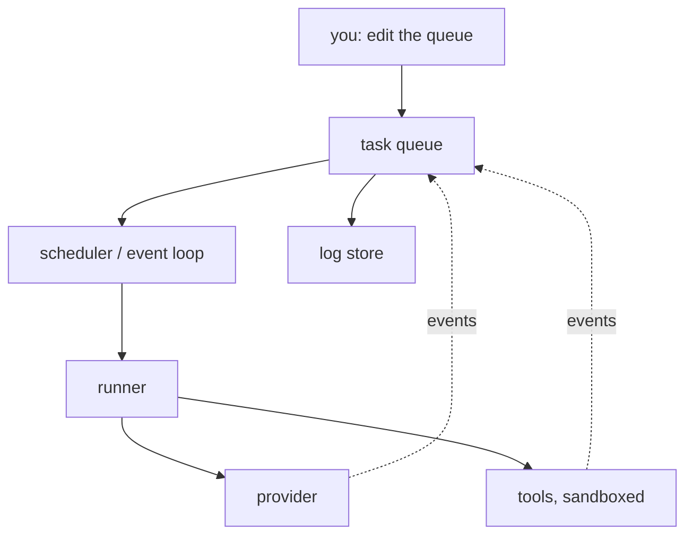

# PEARL

**P**ause, **e**dit, **a**sk, **r**esume — **l**ive.

A queue-centric agent development environment in Rust. You shape a visible,
editable task queue while the agent works; your attention stays single-thread
while execution runs in parallel underneath. The code is the agent's to write
and take back; the queue is yours to edit.

## The promise

- A task queue that is a tree in data and a single-focus flat list in view, with
  the focused task's report beside it — you read what the agent produced while
  you shape the next task, and while it works the pane names what it is doing.
- Take a node into the hand, edit it, place it back: steering, follow-up,
  preempt, hold, and nesting as queue operations the system guarantees, persisted
  outside the model context so fold cannot drop them.
- Every operation class — edit, write, shell — runs confined and can be
  taken back, on macOS, Linux, and Windows alike
  ([below](#every-write-can-be-taken-back)).
- One provider interface; DeepSeek first, any OpenAI-compatible endpoint by URL.
  `:` switches the model, the thinking effort and the fold window while the work
  runs — the next request carries them, and a status line says what is in force.
- A log that outgrows its window folds its oldest messages into a summary
  written to the log, so a resume reads it instead of paying a model for it
  again.
- A side question (`b`, the `/btw` move) answered beside the work, entering
  neither the queue nor the log.

## Every write can be taken back

An agent that can edit your files can also run a shell, and the shell is where
the undo promise usually ends: an edit can be hooked, but a command is arbitrary
code. Most tools pick one — confine the shell, or snapshot the edits — and the
guarantee stops at the boundary of whichever they picked.

PEARL keeps both guarantees for every operation class, on all three operating
systems, with nothing for you to install:

- **Confinement** is the OS's own primitive: Seatbelt on macOS, Landlock on
  Linux, an AppContainer inside a kill-on-close Job Object on Windows. No VM,
  no FUSE, no kernel extension.
- **Revert** is a before-image: edits keep a per-file snapshot; every shell op
  captures a baseline of the workspace and can be restored by op id — changed
  files go back, created files are removed, deleted files return. The bytes wait
  on disk under content-derived names, so a long run keeps one copy of each
  unchanged file instead of one per command, and pearl's own log is never part
  of an undo.
- **Fan-out**: the model splits a task with `subagent`; the children run at the
  same time in their own copies and their answers come back in the same round.
- **Visibility**: the status row shows the window's fill and its fold count
  while work runs, so a fold is never a silent forgetting.
- **Reach**: `z` takes the newest op back from the keyboard and names the
  command it undid; the model has the same move as `revert_bash(op)`. Neither
  waits for a round to finish.
- **Independence**: each op owns its before-image, so taking one op back never
  touches another's. Subagents run at the same time, each in its own workspace
  copy, so one child's revert cannot reach another's tree (ADR 15).

The price is stated, not hidden: a shell op's revert is the whole tree,
newest-first, and effects outside the workspace — a network call, a system
setting — are confined, not rewound.

## The story

<!-- STORY SLOT: a vivid, universal scene goes here; comic panels later. -->

The IDE grew big, and then the agent grew big, and the IDE was left hollow. Two
giants now share one desk and fight for one pair of eyes. You used to hold the
whole program in your head; now you hold a prompt, and wait, and the waiting is
where the flow breaks. You tab between runs to feel busy, and the busyness
is the opposite of flow. What you wanted was never two windows. It was one
thing, small, that holds the loop while you keep your hands on it: a queue you
can edit while the agents run, one cursor for your attention, many hands for the
work, and every write something you can take back. PEARL is that small thing.

## What it is not

- Not an editor view: the agent generates the code; you shape the queue.
- No LSP: the compiler is the feedback channel, not a language server you install.
- No parallel attention: subagents are many hands under one queue, but you tend
  one focus.
- Not a container: the boundary is a copy, a confinement you can see and kill.

## Install

A release tag publishes one raw binary per platform on the [releases
page][releases] — `pearl-vX.Y.Z-aarch64-apple-darwin`,
`-x86_64-unknown-linux-gnu`, `-x86_64-pc-windows-msvc.exe`. Download it, make it
executable if your system cares, and run it. Nothing else to install.

[releases]: https://github.com/OverbearingPearl/pearl/releases

To build from source, PEARL's CI is the shared `ci-rust` suite, pulled as a
subtree and bootstrapped:

```sh
git subtree add --prefix=ci https://github.com/OverbearingPearl/ci-rust main --squash
ci/bootstrap.sh
make lint
make test
```

```sh
cargo build --workspace
cargo run -p pearl                      # the surface
DEEPSEEK_API_KEY=... cargo run -p pearl -- run "summarize this repo"
```

`pearl` with no argument opens the surface, because the surface is the program:
a flat list you edit by keyboard: `a` appends a task, `t` takes one into the
hand, `p`/`P` places it after the focus or at the front, `r` rewrites a live
task's objective in place, `s` steers the running one, `n` nests a part, `␠`
pauses or starts it, `c` cancels it, `/` asks beside the work, and `q` leaves.
A prompt holds a paragraph: `⇧⏎` breaks the line (or `M-⏎`, `C-j` in emacs),
`Tab` gives the keys back to the queue while the words wait, and `Esc` puts a
draft down. `y` copies the focused task -- its words, its notices, its answer
-- to the clipboard.
Keys are ASCII. With an input method in full-width punctuation `:` arrives as
`：` and is not a key: make it half-width, as for every terminal program.
PEARL does not guess an input method's state, and adds no full-width aliases.

`pearl run` is the one task you fire and forget; `pearl queue` is the same
surface as the default, kept as a name. `--log` names the file either one
writes: the surface keeps the conversation it carries in
`pearl-log.jsonl` in the working directory unless it is told otherwise, and
that file is every run in that directory replayed on the next request -- so a
second window, a driven test, or a human starting clean passes one of its own
rather than shares the human's. A launch carries on with what the directory
left: the list and the conversation come back, with every unfinished task held
so nothing starts itself. `--fresh` begins again on purpose and writes the mark
that puts the older runs out of the request's view.

A task placed on the surface runs: the process starts one runner over the same
queue, so the list stays editable while it works and a badge tells you what it
is doing. `PEARL_BASE_URL` points the same provider at any OpenAI-compatible
endpoint, which is how a local model answers the same questions.

`PEARL_EVENT_LOG=/tmp/keys.log` writes one line per event the surface read
(`key Char('q') NONE`, `paste 11 chars`), for the reports that cannot be
answered by reading the code -- a terminal, an input method, and a keymap
disagree about who saw a keystroke, and this says which.

## Two architectures

The layers, and the direction a `use` may point:



The flow of intent and the flow of events:



You never talk to the runner directly; you shape the queue, and the queue
drives the loop. Results flow back as queue status events.

## Reading on

| Document | What it holds |
|----------|---------------|
| [AGENTS.md](AGENTS.md) | How work lands: process, commits, stories, layers |
| [docs/architecture.md](docs/architecture.md) | The units, the layers, the mechanisms |
| [docs/glossary.md](docs/glossary.md) | The words this design uses |
| [docs/roadmap.md](docs/roadmap.md) | The promises and the acceptance that proves them |
| [docs/decisions/decisions.md](docs/decisions/decisions.md) | The settled decisions |

## Development

`make lint` is the gate; `make test` runs the stories. Every test is a
Given-When-Then story that fails without the feature. See [AGENTS.md](AGENTS.md)
for the discipline.

## License

MIT.