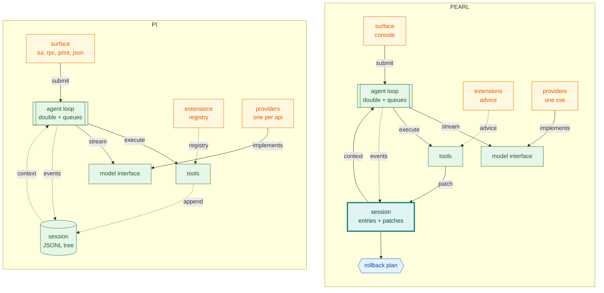

# PEARL

**P**i · **E**macs · **A**gent · **R**evertible · **L**isp

> A coding agent inside Emacs: Pi's loop, the editor's hands, and edits you take
> back with `C-/`.

PEARL's control flow is [Pi](https://github.com/earendil-works/pi)'s agent loop
— a small, model-agnostic loop that calls tools and feeds the results back. Everything the
loop touches is Emacs: buffers carry the context, `undo` carries the safety net,
and the editor's own vocabulary carries what the agent reports.

No Node process, no provider matrix, no plugin registry. One loop, one console,
a handful of tools.

What works today, and what comes next, is in [docs/roadmap.md](docs/roadmap.md).

## The promise

> Change a file through PEARL, press `C-/`, and it is as if the agent had not
> touched it.

Three consequences, and they are the whole product:

- **No per-hunk approval.** Edits apply as they are planned. Approving every
  change taxes every correct edit to guard against a failure that undo already
  covers.
- **Every change is reported as it lands.** Nothing disappears quietly into the
  tree; the console is the record of what happened, and it can be read back
  afterwards.
- **The undo is the one you already use.** A tool call is one `undo` step in the
  buffer it edited, not a separate history with its own commands.

## What PEARL is, and is not

It is an agent inside your editor, with your buffers as its context, small
enough to read: one loop, one console, tools you can count. It is not a terminal
agent with an Emacs front end, and not a platform — no plugin registry, no MCP.

## Where it differs from Pi

One picture, two halves, each read top-down. The PI half is Pi's real
architecture. The PEARL half is the same picture after the deltas, node for
node, so the two can be compared by scanning. The text names the halves rather
than pointing at a side, because a renderer may put either one first.

<!-- Two rules keep this block renderable, both found by rendering it.

     A cross-subgraph edge overrides `direction` inside a subgraph, and both
     panels need `direction TB` to read top-down. So nothing may connect the
     panels: the deltas live in the colour and the labels instead.

     The order of the two panels is not ours to set. Mermaid puts PEARL first
     whatever the declaration order or the subgraph ids; the ASCII renderer used
     to check these files puts whichever is declared first. Since the two
     disagree, the prose names the halves rather than pointing at a side.

     Left-to-right order inside a rank is dagre's call too: `providers` lands
     next to `model interface`, so the panels declare the loop's `execute` and
     `stream` edges in opposite orders to get `providers` on the same side in
     both. A `~~~` hidden link cannot do that: it is still a layout edge, so it
     pushes a node down a rank and the shared row collapses. -->



Colour is the only mark whose meaning is relative to the other half. A shape or
a line style means the same thing on both sides:

| mark | meaning |
| --- | --- |
|  | this half keeps it: the module, its seam, its job |
|  | this pair changed in place: four surfaces become one console, a registry becomes advice, adapters per api become one |
|  | this pair moved: the shape of the session leaves the application layer and enters the core |
|  | this is new: the rollback plan |
|  | a module, or the record the core owns (`["…"]`); a cylinder is a store that owns a file (`[("…")]`) |
|  | an artifact derived from the records, not a module (`{{"…"}}`); a box flanked by bars is a control structure (`[["…"]]`) |
|  | data the receiver uses, handed over by the tail, in the same step (`-->`) |
|  | the tail does not complete it: either nobody waits for it (`events`), or a layer this panel does not draw does it (`context` and `append` in the PI half) (`-.->`) |

The bracket in each row is the Mermaid spelling, so the legend, the block above
and the rendered figure all agree on one vocabulary.

Both halves draw `events` out and `context` back, and the difference is where
they run. `events` is dashed in both: the loop emits and never waits. `context`
comes back in both, and the line style is the point: dashed in the PI half,
because the read path runs through the application layer, and solid in the PEARL
half, because the core records and the core reads back. What that buys is
[docs/architecture.md#the-two-rings](docs/architecture.md#the-two-rings).

Dropped, and therefore absent from the PEARL half: RPC, the print and JSON
modes, MCP, codemode, compaction, and the extension registry.

## Relationship to Pi

PEARL translates Pi's **loop** and builds a different product around it.

The machinery is Pi's, copied rather than redesigned: the double loop, the two
message channels, the event taxonomy, the tool protocol, and the eleven
behaviours in
[docs/adr/0008-what-we-take-from-pi-verbatim.md](docs/adr/0008-what-we-take-from-pi-verbatim.md).
What differs is where state lives, how undo works, how extensions attach, and how
many providers exist — one record each in [docs/adr/](docs/adr/),
with its price.

It is not a fork: no Pi code is vendored, and the two are free to diverge. Pi is
MIT-licensed, originally created by Mario Zechner and now maintained under
`earendil-works/pi`; PEARL is MIT too.

## Reading on

| Document | Answers |
| --- | --- |
| [docs/adr/](docs/adr/) | one record per decision: what PEARL does differently from Pi, what it costs, and what would overturn it |
| [docs/architecture.md](docs/architecture.md) | how the parts fit: two rings, four rules, three layers |
| [docs/glossary.md](docs/glossary.md) | one word, one meaning |
| [docs/roadmap.md](docs/roadmap.md) | what exists today, and the order the rest arrives in |

## Development

Layout: `pearl.el` is the only `.el` at the repository root, business modules
live in `lisp/`, tests in `test/`, design notes in `docs/`, decisions in
`docs/adr/`. The check suite in `ci/` is a subtree of
[ci-elisp](https://github.com/OverbearingPearl/ci-elisp) and is not edited here;
this project's settings for it are in `config/ci.el`. `vendor/` holds the one
third-party file the tests need, and nothing else.

```sh
make lint    # checkdoc, package-lint, byte-compile, format, headers, layering, ADR shape
make test    # ERT over test/*.el
scripts/adr new "Title" --summary "One paragraph."   # add a record
```

A test is a story, not a case: it is written in `ert-gwt`'s Given-When-Then
form and it comes before the module it exercises. `make test` is therefore
allowed to be red while a stage is being built; `make lint` is not. The rules
an agent working in this repository follows are in [AGENTS.md](AGENTS.md).

`make lint` is byte-for-byte what CI runs, so a green local run means a green
`lint` job. The check suite and pipeline are described in
[`ci/README.md`](ci/README.md), which ships with the subtree.

## License

MIT. See [`LICENSE`](LICENSE); the copyright holder is OverbearingPearl.
