# PEARL

**P**i · **E**macs · **A**gent · **R**evertible · **L**isp

> A coding agent inside Emacs: Pi's loop, the editor's hands, and edits you take
> back with `C-/`.

PEARL's control flow is [Pi](https://github.com/earendil-works/pi)'s agent loop
— a small, model-agnostic loop that calls tools and feeds the results back. Everything the
loop touches is Emacs: buffers carry the context, `undo` carries the safety net,
and the editor's own vocabulary carries what the agent reports.

No Node process, no provider matrix, no plugin registry. One loop, one console,
a handful of tools.

What works today, and what comes next, is in [docs/roadmap.md](docs/roadmap.md).

## The promise

> Change a file through PEARL, press `C-/`, and the buffer is as if the agent
> had not touched it. The saved file follows your next save; to take a whole
> turn back on disk, the console's rollback restores the files themselves.

Three consequences, and they are the whole product:

- **No per-hunk approval.** Edits apply as they are planned. Approving every
  change taxes every correct edit to guard against a failure that undo already
  covers.
- **Every change is reported as it lands.** Nothing disappears quietly into the
  tree; the console is the record of what happened, and a session you close is
  one you can reopen where it stopped.
- **The undo is the one you already use.** A tool call is one `undo` step in the
  buffer it edited, not a separate history with its own commands.

## What PEARL is, and is not

It is an agent inside your editor, with your buffers as its context, small
enough to read: one loop, one console, tools you can count. It is not a terminal
agent with an Emacs front end, and not a platform — no plugin registry, no MCP.

## Installing

PEARL is not on MELPA yet; what will be published is [the
recipe](packaging/melpa/pearl), and
[docs/releasing.md](docs/releasing.md) is the path from a checkout to a tag
and a pull request. Until then a checkout on `load-path` is the install:

```elisp
;; straight.el
(straight-use-package
 '(pearl :type git :host github :repo "OverbearingPearl/pearl"))

;; or a clone you keep yourself
(use-package pearl
  :load-path "~/projects/pearl"
  :commands (pearl pearl-console-mode))
```

`pearl` is autoloaded, so no configuration is needed before the first use.
It refuses to start without `git` on the path, because a turn it cannot take
back is a turn it will not run.

### Keys in the console

| key | what it does |
| --- | --- |
| `RET` | send the line at point; while a run is in flight it steers instead |
| `C-c C-k` | stop the run, keeping the tool results it already has |
| `C-c C-m` | pick the model for this console, remembered for the session |
| `C-c C-r` | take the last turn back on disk |
| `C-c C-t` | draw every turn recorded under the project |
| `C-c C-u` | take back the turn at point, whichever session wrote it |
| `C-c C-c` | summarise the oldest turns and carry on from the summary |
| `C-/` | undo an edit the agent made, in the buffer it made it in |

### The three settings

```elisp
(setq pearl-app-provider              ; nil builds the SSE client
      nil
      pearl-provider-sse-base-url     ; the endpoint's /v1
      "https://api.openai.com/v1"
      pearl-app-user-instructions-file
      (locate-user-emacs-file "pearl/AGENTS.md"))
```

The key is never a variable. It is read when a request is made, in this
order: `auth-source` for the endpoint's host, `PEARL_API_KEY` in the
environment, and one prompt that is remembered for the session
([ADR 17](docs/decisions/0017-why-the-api-key-is-resolved-at-use-not-stored.md)).
The model comes from `pearl-console-model-default` or, when that is nil, the
first `C-c C-m`; `pearl-console-models` is the list it offers.

The project's instructions are `AGENTS.md` at the root you open, and yours
are the file above, if either exists. Why the prompt is three sections with
one owner each, and why there is no function to append to, is
[ADR 21](docs/decisions/0021-why-the-prompt-has-one-mechanism-and-not-a-seam-beside-it.md).

## Where it differs from Pi

One picture, two halves, each read top-down. The PI half is Pi's real
architecture. The PEARL half is the same picture after the deltas: the shared
jobs sit where Pi puts them, so a reader can compare the two by scanning, and
what has no counterpart is drawn too, in blue, because "there is nothing to put
beside it" is a fact about the design and not a reason to leave it out. The text names the halves rather
than pointing at a side, because a renderer may put either one first.

<!-- The figure is content only: what exists, and what points at what. Nothing
     in it is there to place a node, so a reader who finds the two halves laid
     out differently has found a renderer's choice and not a claim. Every solid
     arrow names a call that is in the code; a dotted one names an event, a
     value handed back, a relation, or a step marked as not built. -->

```mermaid
flowchart TB
  subgraph R["PEARL"]
    direction TB
    r_surf["surface<br/>console"] <-->|submit, events| r_loop[["agent loop<br/>double + queues"]]
    r_loop <-->|execute, patch in the result| r_tools["tools"]
    r_loop -->|stream| r_model["model interface"]
    r_loop <-->|append entries, projection| r_sess["session<br/>entries + patches"]
    r_tools -.->|asks before it writes| r_surf
    r_loop -.->|tool-execution-end| r_review["review<br/>next-error"]
    r_sess -->|asks for the preamble| r_prompt["prompt<br/>preamble + sources"]
    r_sess -.->|points at| r_leaf["head<br/>moves, never copies"]
    r_sess --> r_plan{{"rollback plan"}}
    r_sess <-->|every branch read, the undo written back| r_time{{"undo page"}}
    r_time -->|asks for a plan| r_plan
    r_compact["compaction<br/>entry, spans kept"] -->|covers entries| r_sess
    r_app["app<br/>compose"] -->|creates| r_surf
    r_app -->|opens| r_sess
    r_app -->|installs| r_tools
    r_app -->|summarises into| r_compact
    r_ext["extensions<br/>data seams, no advice"] -.->|tool list| r_tools
    r_ext -.->|mode hook| r_surf
    r_surf -.->|cut| r_rpc[/"rpc"/]
    r_surf -.->|cut| r_print[/"print mode"/]
    r_surf -.->|cut| r_json[/"json mode"/]
    r_ext -.->|cut| r_registry[/"registry"/]
    r_ext -.->|cut| r_mcp[/"mcp"/]
    r_ext -.->|cut| r_codemode[/"codemode"/]
    r_prov["providers<br/>one sse"] -->|implements| r_model
    r_delegate["delegate<br/>a session of its own<br/>M11, not built"] -.->|will fork| r_loop
  end
  subgraph L["PI"]
    direction TB
    l_surf["surface<br/>one of four"] <-->|submit, events| l_loop[["agent loop<br/>double + queues"]]
    l_surf -.->|frontend| l_tui["tui"]
    l_surf -.->|frontend| l_rpc[/"rpc"/]
    l_surf -.->|frontend| l_print[/"print mode"/]
    l_surf -.->|frontend| l_json[/"json mode"/]
    l_loop <-->|execute, result| l_tools["tools"]
    l_loop -->|stream| l_model["model interface"]
    l_loop <-->|append, context| l_sess[("session<br/>JSONL tree")]
    l_sess -.->|points at| l_leaf["head<br/>leaf pointer"]
    l_compact["compaction<br/>summary, spans omitted"] -.->|omits them| l_sess
    l_ext["extensions"] -.->|registry| l_tools
    l_ext -.->|seam| l_registry[/"registry"/]
    l_ext -.->|extension| l_mcp[/"mcp"/]
    l_ext -.->|extension| l_codemode[/"codemode"/]
    l_prov["providers<br/>one per api"] -->|implements| l_model
    l_delegate["acp_delegate<br/>shipped by a plugin"] -.->|spawns a child pi| l_surf
  end
  classDef base fill:#eceff1,stroke:#607d8b,color:#263238
  classDef keep fill:#e8f5e9,stroke:#2e7d32,color:#1b5e20
  classDef moved fill:#e0f2f1,stroke:#00796b,color:#004d40,stroke-width:3px
  classDef added fill:#e3f2fd,stroke:#1565c0,color:#0d47a1
  classDef changed fill:#fff8e1,stroke:#ef6c00,color:#e65100
  classDef planned fill:#f5f5f5,stroke:#9e9e9e,color:#424242,stroke-dasharray:4 2
  classDef removed fill:#ffffff,stroke:#b71c1c,color:#b71c1c,stroke-dasharray:2 3
  class r_loop,r_model,r_tools,r_leaf,r_tui keep
  class r_surf,r_ext,r_prov,r_compact changed
  class r_app added
  class r_sess moved
  class r_plan,r_time,r_review,r_prompt added
  class r_delegate planned
  class r_rpc,r_print,r_json,r_registry,r_mcp,r_codemode removed
  class l_surf,l_tui,l_rpc,l_print,l_json,l_registry,l_mcp,l_codemode base
  class l_loop,l_model,l_tools,l_sess,l_leaf,l_compact,l_ext,l_prov,l_delegate base
```



The PI half is the reference and is drawn in one tone, because a colour there
would be a verdict about a package this figure is not rating. Every mark is in
the PEARL half, and each node there carries exactly one:

| mark | verdict | which nodes |
| --- | --- | --- |
|  | **kept** — same module, same job | `loop`, `tools`, `model interface`, the head a session points at |
|  | **improved in place** — the node stays, what it does is different | `surface` (one console where Pi has four frontends), `providers` (one adapter, not one per api), `compaction` (an entry the projection obeys, not a range rewritten), `extensions` (two data seams, no registry) |
|  | **moved** — same job, different layer | `session` (the record leaves the application and enters the core, carrying patches) |
|  | **added** — no Pi node to stand beside it | `app`, `prompt`, `rollback plan`, `undo page`, `review` |
|  | **dropped** — Pi has it and this half does not. A parallelogram, because it is a frontend or a seam and not a module, hanging on a dotted edge off the node it belonged to | `rpc`, `print mode`, `json mode`, off the surface; `registry`, `mcp`, `codemode`, off the extensions |
|  | **not built yet** | `delegate` (M11; Pi's is shipped by a plugin) |

Shape and line style mean the same thing on both sides:

| mark | meaning |
| --- | --- |
|  | a module, or the record the core owns (`["…"]`) |
|  | a store that owns a file (`[("…")]`) |
|  | an artifact derived from the records, not a module (`{{"…"}}`) |
|  | a control structure, not a module: the loop that queues (`[["…"]]`) |
|  | a call in one direction: the tail asks, the head answers or acts, in the same step (`-->`) |
|  | one step both ways, drawn once: the tail asks and the head hands something back (`<-->`). Splitting it into two arrows would put a two-node cycle in the graph, and a layout engine breaks a cycle by reversing an edge, which is how an arrow that means "submit" ends up drawn pointing the other way |
|  | not a call: an event nobody waits on (`events`), a value handed back inside a result (`patch in the result`, `result`, `tool-execution-end`), a relation the record already has (`points at`, `tool list`, `mode hook`), or a step that is not there at all (`cut`, `delegate`) (`-.->`) |

What is dropped is drawn in the PEARL half on a dotted edge off the node it
belonged to, never as a note inside a surviving label: `rpc`, the print mode and
the JSON mode hang off the surface, `registry`, `mcp` and `codemode` off the
extensions. The PI half shows the same six as ordinary nodes in its own tone,
because there they are ordinary — three frontends beside the tui, three seams
beside the tools they add to. Reading across is what turns one into the other:
the console is what the tui became, and the two data seams are what a registry
became.
[ADR 9](docs/decisions/0009-what-pearl-deliberately-does-not-build.md) argues
each one.

The bracket in each row is the Mermaid spelling, so the legend, the block above
and the rendered figure all agree on one vocabulary.

Both halves draw the same round trip between the loop and the session — the loop
appends, the reader comes back — and the difference is which layer answers. In Pi
that read runs through the application layer; in PEARL the core records and the
core reads back, which is
[docs/architecture.md#the-two-rings](docs/architecture.md#the-two-rings) and what
ADR 3 decided. The arrow is drawn once in both halves because it is one round
trip, not two.

`events` is not a call and is not drawn as one: the loop emits and never waits
for the surface, which is ADR 26. The same arrow carries `submit` the other way,
and the two arrowheads are two different mechanisms sharing a line.

Five nodes are blue, all of them in the PEARL half, because it has machinery Pi
does not: `app/compose`
opens the console, opens the record, installs the tools and runs the one
compaction; `prompt` is a module of its own, asked for the preamble by the
projection; `rollback plan` answers "what would going back cost" without going
back; `undo page` reads every session of a
root and asks the rollback plan for the note it is standing on, which is a view
Pi has no equivalent for, since its rewind is
conversational only ([ADR 30](docs/decisions/0030-why-undo-is-a-view-over-the-root-and-an-act-on-one-branch.md));
`review/next-error` hands a failing build to the editor's own keys, which is the
one place PEARL is not modelling Pi at all.

`compaction` is the pair whose *shape* differs while its job does not: both
write a summary entry and let the projection omit the covered range, and they
differ in what the entry names — Pi records the boundary it kept
(`firstKeptEntryId`), PEARL records the ids it covers, so `pearl-session-expand`
can hand the omitted turns back and the surface can show them as a fold ([ADR 27](docs/decisions/0027-why-compaction-is-a-projection-and-not-a-rewrite.md)).
It is therefore amber rather than blue: one job, two spellings, and the picture
should be read as "changed", not as "added".

The PEARL half carries the rollback plan and the undo page below the session
because taking a change back on disk is the job Pi leaves to git.

`extensions` is amber and marked "no seam yet": the decision that there will be
no registry is settled (ADR 6), and what it leaves is two data structures — the
tool list and the console's major mode hook — which no package yet uses. ADR 6
also names advice as the way in, and no advice is installed anywhere in
`lisp/`: the seams that exist are the two above.

`delegate` is the one node that is grey on both sides, because honesty about a
feature nobody has built here should be visible rather than remembered: Pi ships
`acp_delegate` from a plugin that spawns a child against its own session file,
and PEARL has the shape recorded (ADR 31) and none of it built (M11).

What the picture still does not draw: the three files the prompt is assembled
from, the JSONL adapter and its lock, and where a patch comes from. Each is a
leaf of a node that is drawn, and
[docs/architecture.md](docs/architecture.md) is the list of modules.

Compaction is the one node where the three verdicts nearly collide: it is
improved rather than added, because Pi compacts too, and it is not dropped,
because a session that rewrote its own history could not be replayed
([ADR 27](docs/decisions/0027-why-compaction-is-a-projection-and-not-a-rewrite.md)).

## Relationship to Pi

PEARL translates Pi's **loop** and builds a different product around it.

The machinery is Pi's, copied rather than redesigned: the double loop, the two
message channels, the event taxonomy, the tool protocol, and the behaviours in
[docs/decisions/0008-what-we-take-from-pi-verbatim.md](docs/decisions/0008-what-we-take-from-pi-verbatim.md).
What differs is where state lives, how undo works, how extensions attach, and how
many providers exist — one record each in [docs/decisions/](docs/decisions/),
with its price.

It is not a fork: no Pi code is vendored, and the two are free to diverge. Pi is
MIT-licensed, originally created by Mario Zechner and now maintained under
`earendil-works/pi`; PEARL is MIT too.

## Reading on

| Document | Answers |
| --- | --- |
| [docs/decisions/](docs/decisions/) | one record per decision: what PEARL does differently from Pi, what it costs, and what would overturn it |
| [docs/architecture.md](docs/architecture.md) | how the parts fit: two rings, three layers, and the rules each one is held to |
| [docs/glossary.md](docs/glossary.md) | one word, one meaning |
| [docs/roadmap.md](docs/roadmap.md) | what exists today, and the order the rest arrives in |
| [docs/releasing.md](docs/releasing.md) | what a release owes, and how the package reaches MELPA |

## Development

Layout: `pearl.el` is the only `.el` at the repository root, business modules
live in `lisp/`, tests in `test/`, design notes in `docs/`, decisions in
`docs/decisions/`. The check suite in `ci/` is a subtree of
[ci-elisp](https://github.com/OverbearingPearl/ci-elisp) and is not edited here;
this project's settings for it are in `config/ci.el`. `vendor/` holds the one
third-party file the tests need, and nothing else.

```sh
make lint    # checkdoc, package-lint, byte-compile, format, headers, layering, ADR shape
make test    # ERT over test/*.el
PEARL_PERF_SCALE=2 make test   # on a loaded machine: relax the two latency budgets
scripts/adr new "Title"   # the only supported way to add a decision record
```

A test is a story, not a case: it is written in `ert-gwt`'s Given-When-Then
form and it comes before the module it exercises. `make test` is therefore
allowed to be red while a stage is being built; `make lint` is not. The rules
an agent working in this repository follows are in [AGENTS.md](AGENTS.md).

`make lint` is byte-for-byte what CI runs, so a green local run means a green
`lint` job. The check suite and pipeline are described in
[`ci/README.md`](ci/README.md), which ships with the subtree.

## License

MIT. See [`LICENSE`](LICENSE); the copyright holder is OverbearingPearl.
