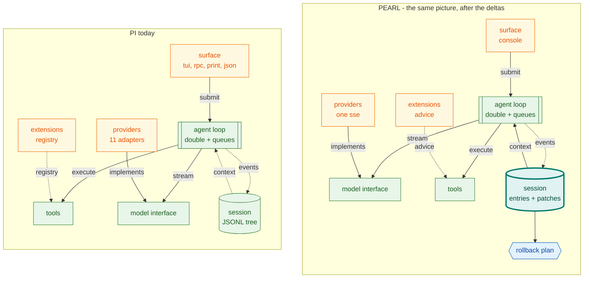

# PEARL

**P**i · **E**macs · **A**gent · **R**uns · **L**isp

> Pi's agent loop, reborn in Emacs Lisp.

PEARL is a Lisp-native reimplementation of [Pi](https://github.com/earendil-works/pi)'s
agent runtime for Emacs. It borrows Pi's defining structure — a minimal, model-agnostic
loop that calls tools and feeds results back — and expresses it in Emacs Lisp.

No Node. No npm. Just Emacs, a loop, and `eval`.

---

## Why Lisp?

Pi's core is deliberately small. `pi-agent-core` is described as a "small
provider-agnostic agent loop," and the project's own framing is that Pi keeps
"only the agent loop, tools, and providers" — everything else is left to
extensions. That design already leans Lisp-ward: a small
executable core, with behavior extended by redefinition rather than configuration.

Emacs Lisp makes the rest literal:

- **The loop is already an Emacs idiom.** Emacs has a native event loop, native
  queues, and native `condition-case`. An agent loop does not need a bridge to
  another runtime.
- **Extensibility is the platform.** Extensions in Emacs are packages that advise,
  override, or wrap functions. An agent that expects to be extended this way does
  not need a plugin registry.
- **There is precedent.** `macher-agent` is an "Emacs-native LLM agent harness"
  with asynchronous sub-agent orchestration. `magent` implements its
  agent loop, tool calls, permissions, sessions, and child agents in Emacs Lisp,
  using `gptel` only for model requests. PEARL is not proposing a new
  possibility; it is applying an existing pattern to Pi's specific loop architecture.

---

## What PEARL keeps, adds and drops

One picture, two halves, each read top-down. The left half is Pi's real
architecture. The right half is not PEARL's own structure; it is the same picture
after the deltas, node for node, so the two can be compared by scanning.

<!-- Mermaid draws subgraphs in reverse declaration order, and a cross-subgraph
     edge overrides `direction` inside one. Both panels declare `direction TB`
     and keep no edges between them, so they stay vertical and side by side.
     Declaring PEARL first is what puts PI on the left.

     Left-to-right order inside a rank is dagre's call, not the source order:
     `providers` always lands next to `model interface`, so the two panels
     declare the loop's `execute` and `stream` edges in opposite orders to get
     `providers` on the left in both. A `~~~` hidden link cannot do this: it is
     still a layout edge, so it pushes one node down a rank and the shared row
     collapses. -->



Colour is the only thing whose meaning changes between the halves:

| mark | meaning |
| --- | --- |
| green | kept as it is |
| amber | changed in place: four surfaces become one console, a registry becomes advice, eleven adapters become one |
| teal, thick border | moved: session leaves the application layer and enters the core |
| blue, hexagon | added: the rollback plan |
| dashed edge | real, but carried by a layer that is not in this panel |
| solid edge | this module does it |

Dropped, and therefore absent from the right half: RPC, the print and JSON
modes, MCP, codemode, compaction.

Both halves now draw the same two edges, and the difference is where they run.
`events` goes out in both, and it is dashed in both: the loop emits and never
waits. `context` comes back in both, and the line style is the whole point.

On the left it is dashed, because the read path does run through the
application layer: the product subscribes to events,
appends entries, and replays the branch into the next request. Nothing in the
core knows a session exists, which is why a second consumer of the runtime has
to rebuild persistence rather than reuse it. On the right it is solid, because
session sits in the core and the ring closes inside one band: the core records
and the core reads back.

A guarantee that a layer above has to remember to keep is a
convention; the patch and the tool result are recorded in one step by the thing
that promises revertibility.

Why each decision costs what it costs, and what would overturn it, is in
[docs/differences.md](docs/differences.md). The layer rules the picture follows
are in [docs/architecture.md#layers](docs/architecture.md#layers).

## Relationship to Pi

PEARL is **not** an official Pi project, and it is **not** a fork.

It is a translation: same control-flow architecture, different language. PEARL
borrows Pi's nested loop structure and its two future-message channels — steering
and follow-up — and expresses them in Emacs Lisp. APIs, data structures, and
extension points will diverge where Lisp offers a better idiom.

Pi is MIT-licensed, originally created by Mario Zechner and now maintained under
`earendil-works/pi`. PEARL is released under the same MIT terms.

Where PEARL deliberately differs from Pi, and why →
[docs/differences.md](docs/differences.md).

### Prior art

Two claims here — that code should be located by tooling rather than by the
model, and that an applied edit has to be revertible — come from an earlier
Emacs project by the same author. None of its code is part of PEARL; the
argument for both claims is made in
[docs/differences.md](docs/differences.md).

---

## Architecture (Target)

> **What this section is:** the loop structure PEARL intends to implement, based on
> Pi's `pi-agent-core`. **What this section is not:** a description of finished code.
> The concrete Lisp realization may adapt Pi's control flow to Emacs's async model,
> but the ordering described here is the target.

Pi's agent runtime is a **double nested loop**, implemented in `runLoop` inside
`pi-agent-core`.

<pre>
    ● agent-start
         │
         ▼
╔══════════════════════════════════════════════╗
║  OUTER LOOP                                  ║
║                                              ║
║   ┌──────────────────────────────────────┐   ║
║   │  INNER LOOP                          │   ║
║   │                                      │   ║
║   │   ▸ stream model response            │   ║
║   │   ▸ parse tool calls                 │   ║
║   │   ▸ execute tools                    │   ║
║   │   ▸ inject results                   │   ║
║   │   ▸ consume steering messages        │   ║
║   │                                      │   ║
║   │   ↻  repeat while tool calls or      │   ║
║   │      steering messages remain        │   ║
║   └──────────────────────────────────────┘   ║
║                                              ║
║   follow-up messages queued?                 ║
║     ├── yes ──▶  re-enter INNER LOOP         ║
║     └── no  ──▶  agent ends                  ║
╚══════════════════════════════════════════════╝
         │
         ▼
    ● agent-end
</pre>

**Steering** messages are delivered after the current assistant turn finishes its
active tool calls and before the next model request. They let a caller intervene
mid-run without aborting the run.

**Follow-up** messages are delivered after the agent "would otherwise become idle" —
after the inner loop settles, as a new outer-loop iteration. They let a caller queue
additional work without starting a fresh agent run.

PEARL's job is to express this ordering with Emacs primitives: `condition-case` for
turn-level error handling, a queue for each message channel, and generic functions
for tool dispatch.

---

## Design Principles (Intended)

These are constraints on PEARL's architecture, not claims about current implementation.

1. **The loop is the core.** The outer/inner loop ordering is the product. Tools,
   model adapters, and UI are replaceable functions around it.
2. **No hidden state.** Message queues and session state should be inspectable
   Emacs data (lists, buffers, plists), not private variables inside closures.
3. **Extend by redefinition.** `advice-add`, `cl-defmethod`, and function
   redefinition are the extension surface — not a JSON configuration layer.
4. **Stay small.** If a feature can live outside the loop, it does.

---

## Development

The check suite and the CI pipeline are described in
[`ci/README.md`](ci/README.md). In short:

Layout: `pearl.el` is the only `.el` at the repository root, business modules
live in `lisp/`, tests in `test/`, design notes in `docs/`.

```sh
make lint    # checkdoc, package-lint, byte-compile, format, headers, layering
make test    # ERT over test/*.el
```

`make lint` is byte-for-byte what CI runs, so a green local run means a green
`lint` job. Only MELPA's own tool (melpazoid) runs in CI alone, and it runs
on demand rather than on every push; `ci/README.md` explains why.

## License

MIT. See [`LICENSE`](LICENSE); the copyright holder is OverbearingPearl.

---

## A Note on Pi

PEARL exists because Pi got one thing right: **the agent is the loop.** Not the UI,
not the plugin system, not the model provider list — the loop. Pi's authors had the
discipline to strip the architecture down to that core and the generosity to license
it MIT, which is what makes a rewrite like this possible without asking permission.

This project is a translation, not a competitor. It borrows Pi's loop ordering and
message-channel model and gives them a Lisp accent. If PEARL is ever useful, it is
because Pi was small enough to be understood and open enough to be rebuilt.

— *The PEARL contributors*
