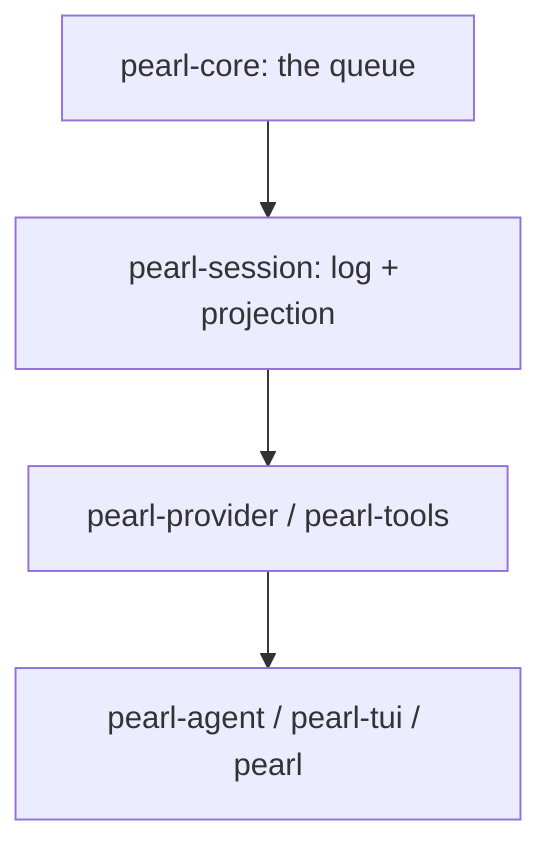
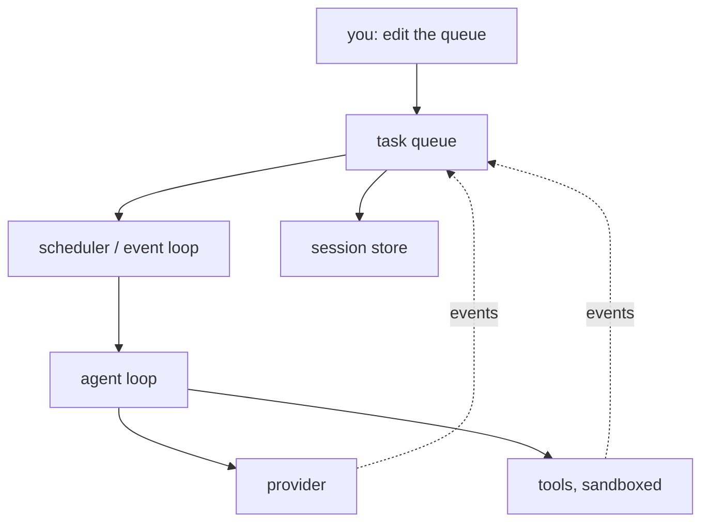

# PEARL

**P**eople **e**dit **a**gent **r**uns, **l**ive.

A queue-centric agent development environment in Rust. You shape a visible,
editable task queue while the agent runs; your attention stays single-thread
while execution runs in parallel underneath. The code is the agent's to write
and take back; the queue is yours to edit.

## The promise

- A task queue that is a tree in data and a single-focus flat list in view.
- Steering, follow-up, preempt, and nesting as queue operations the system
  guarantees, persisted outside the model context so compaction cannot drop them.
- Edits anchored by text and revertible by snapshot; a write is proved only where
  a snapshot can take it back.
- A real sandbox on macOS, Linux, and Windows, each the OS's own primitive.
- One provider interface; DeepSeek first, any OpenAI-compatible endpoint by URL.

## The story

<!-- STORY SLOT: a vivid, universal scene goes here; comic panels later. -->

The IDE grew big, and then the agent grew big, and the IDE was left hollow. Two
giants now share one desk and fight for one pair of eyes. You used to hold the
whole program in your head; now you hold a prompt, and wait, and the waiting is
where the flow breaks. You tab between sessions to feel busy, and the busyness
is the opposite of flow. What you wanted was never two windows. It was one
thing, small, that holds the loop while you keep your hands on it: a queue you
can edit while the agents run, one cursor for your attention, many hands for the
work, and every write something you can take back. PEARL is that small thing.

## What it is not

- Not an editor view: the agent generates the code; you shape the queue.
- No LSP: the compiler is the feedback channel, not a language server you install.
- No parallel attention: subagents run in parallel, but you tend one focus.
- Not a container: the boundary is a copy, a confinement you can see and kill.

## Install

PEARL's CI is the shared `ci-rust` suite, pulled as a subtree and bootstrapped:

```sh
git subtree add --prefix=ci https://github.com/OverbearingPearl/ci-rust main --squash
ci/bootstrap.sh
make lint
make test
```

Build and run the binary:

```sh
cargo build --workspace
DEEPSEEK_API_KEY=... cargo run -p pearl -- run "summarize this repo"
```

## Two architectures

The layers, and the direction a `use` may point:



The flow of intent and the flow of events:



You never talk to the agent loop directly; you shape the queue, and the queue
drives the loop. Results flow back as queue status events.

## Reading on

| Document | What it holds |
|----------|---------------|
| [AGENTS.md](AGENTS.md) | How work lands: process, commits, stories, layers |
| [docs/architecture.md](docs/architecture.md) | The units, the layers, the mechanisms |
| [docs/glossary.md](docs/glossary.md) | The words this design uses |
| [docs/roadmap.md](docs/roadmap.md) | The promises and the acceptance that proves them |
| [docs/decisions/decisions.md](docs/decisions/decisions.md) | The settled decisions |

## Development

`make lint` is the gate; `make test` runs the stories. Every test is a
Given-When-Then story that fails without the feature. See [AGENTS.md](AGENTS.md)
for the discipline.

## License

MIT.