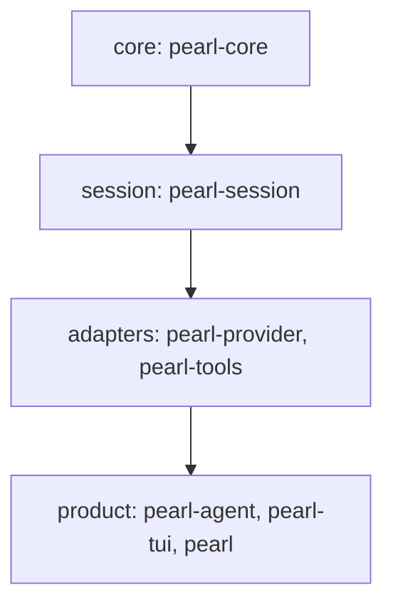

# Architecture

PEARL is a queue-centric agent development environment. The queue is the subject
the human edits; the agent loop carries each node across the wire; the session
remembers; the tools act inside a sandbox. This page names the units, the layers,
and the mechanisms.

## Units

| Crate | Layer | Responsibility |
|-------|-------|----------------|
| `pearl-core` | core | The task queue: tree data, node state machine, scheduler. The moat. |
| `pearl-session` | session | Append-only JSONL log; compaction as a projection. |
| `pearl-provider` | adapters | One provider interface over an OpenAI-compatible wire; DeepSeek first. |
| `pearl-tools` | adapters | Read, anchored revertible edit, write; the per-OS sandbox; the workspace baseline and the copy a fan-out gives each child. |
| `pearl-agent` | product | The loop: dispatch, call, drain steering, persist. |
| `pearl-tui` | product | The single-focus flat view: badges for awareness, a cursor for attention, the focused task's report below it, naming the act while it runs. |
| `pearl` | product | The command line: shape a queue, run it, watch it flow. |

## Layers

A `use` may point only downward; `config/ci.toml` declares the order and the
`layer-order` check enforces it.

## Mechanisms

### The queue is a tree in data, a flat list in view

The data is a tree: a task has subtasks, a subtask may fan out to subagents. The
view is always a single-focus flat list at the current level — narrow to a
subtree, drill in and out. Parallelism is shown as status badges you scan;
attention is the one cursor. The human edits a flat list and navigates, never the
tree directly (ADR 11).

Nesting is a decomposition, so the scheduler is depth-first: a node's unsettled
children run before the node itself, and the node's first request carries what
each settled child found (`<title>: <result>`, a failure included). A held child
holds its whole subtree — the human paused that work, and a detail of it is still
that work. A failed child does not: the parent reads the failure and decides,
rather than being stranded by a part that could not be done. `n` nests a part
under the focused task.

Below the list is the report of the focused task: its reply, or its failure
reason, or — while it runs — the act it is on, or `no report yet` if it has not
started. The loop calls `queue.note(id, act)` before it asks the model and before
each tool call, naming the tool and the path or command it touches; a note is
presentation, so a node that has been cancelled refuses it and the work goes on. The list takes the rows its tasks need up to half the
surface and the report takes the rest, showing the tail so the newest line is the
one in front of the eye. Reading is not a mode you enter — the queue is what the
attention rests on while the agent generates, and the report is what it reads
while shaping the next task.

A key that does not apply is refused by the queue, and the surface shows the
reason on a line above the keys: `resume: this task is running, needs paused or
held-queued`. The message speaks of the state, not the id — the id is a handle
for the program, while the state is what the badge on the screen already says.
A refused placement puts the request back in the hand, so a rejected move never
swallows what the human typed. The notice clears on the next action that works,
or on `Esc`.

### Thinking is kept, not replayed

An endpoint that thinks sends the thinking beside the answer
(`reasoning_content`). It is recorded in the log under its own role and kept on
the node, and it is excluded from both the next request and the transcript a
fold reads: thinking is not a turn the model had, an endpoint that returns it
rejects it as input, and folding it forward would carry the scratch work into
every later context at full price. On screen it is folded away by default —
the answer is what the human came for — and `T` opens it, dimmer than the
answer and labelled, reading before it.

### The log is replayed as the conversation it recorded

Every request is built from the log, so a resumed session is the same
conversation and not a summary of one. That only holds if the log records what
the request carried: an assistant turn that asks for tools writes the calls it
asked for, and each tool turn writes the id it answers. Without those, a replay
is a conversation with a question left unanswered -- which is exactly what
DeepSeek answered, `messages[84]: missing field 'tool_call_id'`, on a task whose
history held tool calls from an earlier one. Turns written before the ids were
recorded have neither, and they are left out of the replay rather than sent
bare: a tool result that names no call is not a turn the model can answer.

### Both windows scroll, and the key says which

Each window has a line motion, a page motion and a jump to either end, and one
rule names the target: **the plain key acts on the queue, Alt acts on the
report**. Every style owes all eight, so the ends are universal too: `Home`/`End`
for the queue, `Alt+Home`/`Alt+End` for the report, beside vim's `gg`/`G` and
`Alt+gg`/`Alt+G` and emacs's `M-<`/`M->` and `C-M-<`/`C-M->`. The legend names
the keys that are bound, not the ones that would read nicely: vim's page is
bare `f`/`b`, one name per motion, and `C-f`/`C-b` are not bound at all -- two
names for one motion, one of which the row has no room to print, is how a
legend stops being the truth. The aside moved to `/` to make room; a letter a
style needs for a motion outranks a letter that names a question. The far end of the
report is a place only the drawing can measure -- wrapping decides how many lines
there are -- so the jump asks for the far end and the view clamps it to the count
it just laid out. What every style
shares is only what all three editors really share: arrows for a line,
`PgUp`/`PgDn` for a page, `Alt` plus either for the report. Letters belong to the
style that owns them -- `j/k` and `J/K` are vim's, `C-n/p` and `C-v/M-v` are
emacs's -- because a vim letter in a plain legend is a vim key wearing the wrong
clothes. Vim adds `f`/`b` and `C-d`/`C-u` for the queue and `Alt` plus the same
keys for the report; emacs has `C-M-v/C-M-S-v`, which is `scroll-other-window`:
emacs already had the report's page as a command rather than a focus to switch
first. On a MacBook `PgUp` is `fn+↑`, which is the plain style's honest answer.

A page is the window's own height, from the same function that lays the panes
out: a page key that jumps a different number of rows than the window shows
lies about what a page is. Paging the queue carries the cursor, because the
window follows the cursor -- it can never end up outside what is on screen.

### Two rows of furniture, one at each edge

The first line leads with the name and carries what the session is and where it
stands: `𝗣𝗘𝗔𝗥𝗟 | deepseek/deepseek-chat (M) | think auto (E) | ctx 0k/128k (W) |
write:~/proj | git:main*8 | plain (\) | mem 14M`. The last line carries the keys,
actions before motions. Everything between them is the work.

The sandbox is named as a directory, because that is what it is: `write:~/proj`
says where the work is and where writes may land in one item, and a policy that
allows nothing says `read-only` in words. `workspace-write` named a policy and
left the reader to guess which directory it meant.

`:` keeps its place beside the settings keys: `m`/`e`/`w` step a ladder and
`M`/`E`/`W` open it to choose from, and `:` is the way to name a value off it --
another house's model, a window of 90000, or `trigger`, which has no ladder.

### No pane focus: every key names its window

There is no notion of which pane is active. The cursor keys always move the
queue, the reading keys always scroll the report, and the legend says so
(`queue j/k  level h/l  report C-u/C-d`). Layout is a separate, direct choice --
`1` queue, `2` report, `3` both, and `C-x 1/2/3` in the emacs style -- so no
keypress has to be interpreted against a mode the human cannot see. A cycle
(`Tab`, `C-x o`) was tried and removed: it makes the next key's meaning depend on
how many times you pressed the last one.

### One order of keys, grouped, in the row and in help

`key_groups()` is the single order: **start** (a add), **look** (the style's
motions and the layout choice), **work** (i now, t take, s steer, n nest, hold,
r resume), **safety** (z undo), **ask** (/ btw, T think), **set** (S save, `:`).
The bottom row is those groups flattened. A legend read in a different order
than it is written is two things to learn.

The motion legend is one slash list per window, in the order a hand uses them:
line, page, ends. `queue ↑↓/PgUp/Dn/Home/End  report Alt+↑↓/PgUp/Dn/Home/End
level ←→  1/2/3 queue/report/both`. A group per motion kind said the same thing
in three places and spent the row's width on the word "page" twice.

`?` is `help_groups()`: the same order, and every row carries its sentence in
both languages. The row has room for a name; a name without its meaning is a key
nobody presses. The look group is a line per window rather than a line per
motion kind -- `queue  j / k line · f / b page · C-d / C-u half · gg / G ends`
-- because the keys are what the eye is scanning for, and a heading per motion
made a three-fact list nine lines long. Keys that belong to one style only
(`C-x 1/2/3`, `C-l`) ride at the end of that style's own window line instead of
opening a row of their own; a key that repeats what the style's list already
says is dropped, so help is the whole list rather than the row plus notes.

`Tab` translates the screen, and neither language is the other's shadow: the
English is written for someone who has never read this repository, the Chinese
for someone who has never read it in English. A word the project invented --
the hand, a level, steer, nest -- is explained where it is used, because a
glossary the reader has to open first is a key they never press. The two
languages are one table, not two: a row
that exists in English and not in Chinese is a key the Chinese reader never
finds, and keeping them side by side is what makes that a compile-shaped
mistake rather than a translation someone forgets. That makes the screen taller
than a terminal, so it scrolls with the same moving keys and says where it is;
any other key closes it.

m, e and w are not in the row: the header already prints each beside the reading
it changes, which is a better place to learn a knob than a list of letters.

While a prompt is open the bottom row is the prompt. A legend drawn over what
the human is typing is a legend that ate their input -- which is exactly what
happened when the rows were merged, and a story caught it.

The settings list obeys the same rule from the other side: it owns the screen,
so its own letters are the only keys that reach it, and `a` and `e` drop it
before they open a prompt. A list left standing over a prompt is a list that
swallowed every letter typed next -- `M` then `a` looked like nothing at all.
`d` keeps the list, because dropping rows is one sitting, and draws what it did
on the list's own last line, because a sentence the screen does not own is a
sentence nobody reads.

### A narrow window drops whole items, and says so

A row cut mid-word is worse than a shorter row: `ctx` without its number and
`b b` without its key look like readings and are not. Every row -- including a
task's row -- is a list of whole items in importance order, fitted to the width,
ending in `…` when anything was dropped. A path shortens from the left, because
the tail is what identifies a directory.

Two things survive every width: `? keys` and `q quit`. A window that hides how to
leave is a window the human has to kill. `?` opens the whole legend on its own
screen, so a narrow window may hide a key but is never the only place it was
written. Height yields in the same order: the ground row goes first, then the
motion row, then the status row; the answer keeps its rows to the last.

### A level is a place, and the heading names it

`narrow` moves the view into a task's parts and `unnarrow` comes back out; the
level keys are `h/l` in vim, `Left/Right` in plain, `^`/`RET` in emacs. The
heading reads `queue 1-2 of 2 in "fix the parser"`, because "(narrowed)" said
that you moved without saying where to, and the way back was a key you had to
trust.

### The screen goes where the attention is

Two panes, a rule under each rather than a box around each: the sides of the
screen hold text. The list windows around the cursor and says where the window
sits in the whole (`queue 33-40 of 40`), so a long queue never hides the task
being worked. The report follows the newest line, and `PgUp`/`PgDn` hold it back
to read; moving the cursor resumes following, because a new task's answer should
not arrive behind a scroll offset from the last one. `Tab` cycles split → report
→ queue, which is the switch between watching the model and reviewing the work.

### Selection is the terminal's

Pearl does not take the mouse. Selection, the scrollback it reaches into,
double-click for a word and the rectangle mode some terminals have are the
terminal's own, and none of them can be reproduced inside an alternate screen
that only knows the rows it drew. A drag that leaves the window takes the
scrollback above it with it -- the build log and the command that started the
run -- because that is what the terminal's screen holds; the alternative was
claiming the left button and reimplementing selection, which stops at the
window's edge and which the terminal still does better.

### Taking a write back is the human's move

The ledger of takeable writes (`pearl_tools::Ops`) is a handle like the queue
and the settings: the runner records each shell op's before-image and command
into it, and `z` at the keyboard restores the newest one without waiting for the
loop or asking the model. The model has the same move through `revert_bash(op)`.
The undo names the command it took back, so the human can match it against what
they saw rather than trust a number.

### The window is visible while it fills

A fold that happens silently is indistinguishable from a model that forgot. The
runner reports each request's billed prompt tokens and each fold into a `Gauge`
handle; the surface reads the same handle, so the status row shows the fill
against the configured window and how many times history has folded. The
reading is the provider's own token count, not an estimate.

### The ground is named on its own row

The knobs and the bill share a row; the ground gets one of its own:
`~/Projects/rust/pearl  git:main*8  sandbox:workspace-write`. Three facts whose
absence is noticed only after the files have changed -- which directory the
writes land in, what the sandbox allows there, which branch a commit would join.

The branch is read from `.git/HEAD` (following a `.git` file into a worktree),
because a subprocess per frame is a cost rather than a reading; the dirty count
asks `git status --porcelain` at most every two seconds and counts untracked
files, since a file the agent created is a change to the tree. An unasked count
shows `*?`, never a clean tree. `RUNNER_POLICY` is declared once in the binary
crate and used by both the runner and the surface, so the row names the
confinement actually in force rather than a second opinion about it.

### One bill, three readings

`Cost` is tokens up, tokens down, elapsed milliseconds and a turn count, from
the provider's own usage and the clock around the request. The same ledger is
read at three scopes, so the readings add up instead of being three opinions:

- a **turn** is itemised in the report (`turn 2  ↑1.2k ↓340 0.4s`), which is how
  you find the round that was expensive rather than only that the task was;
- a **task** carries its total on its queue row, and a child's turns are charged
  to the child -- a parent is not billed twice for work it delegated;
- the **session** total sits on the status line, and includes asides: a side
  question enters no task and no log, but it is still billed.

An empty cost is not rendered. `↑0 ↓0 0.0s` on a task that has not run is a
claim, not a reading.

### The footprint is the kernel's figure

`mem 14M` on the status line is resident memory read from the OS each frame:
`/proc/self/status` on Linux, `MACH_TASK_BASIC_INFO` on macOS,
`GetProcessMemoryInfo` on Windows. No estimate stands in for a number the kernel
already has, and no dependency is taken for one reading. macOS needs
`MACH_TASK_BASIC_INFO` rather than `TASK_BASIC_INFO_64`: the latter answers with
the 32-bit layout and a success code, so every field after the first is garbage
while the call looks like it worked.

### The key is resolved at use, and it can name its house

Two sources, in order: the environment variable of the house the endpoint
belongs to (`DEEPSEEK_API_KEY`, `OPENAI_API_KEY`, derived from the host), then an
authinfo line whose `machine` matches that host -- `~/.authinfo`, or
`~/.authinfo.gpg` decrypted by the user's own `gpg --quiet --batch --decrypt`
when only the encrypted form exists (ADR 20). A `.gpg` file that cannot be
decrypted -- gpg missing, a refusal, a pinentry the ten-second wait cuts off --
is no key, never a fallback to reading the bytes as text, and the decrypted
text is parsed and never logged. The environment wins
because a key set for this run is a deliberate override of a file that serves
every tool on the machine (ADR 17). Nothing is stored, and nothing is read
early: `Houses` is the provider the loop holds, and it asks where the request is
going and who is paying each time it makes one. A client built at launch could
not follow a model chosen at the keyboard -- it would send the new model's name
to the old model's server. No other house's key is borrowed: a wrong key is
worse than no key, because it is sent.

No key is a valid answer. A local server that wants none is asked with no
Authorization header at all, and the surface starts either way -- refusing to
run until a key appears would make every local endpoint second-class.

An authinfo line names the machine, so it can also name the house, and the
status line says `deepseek/deepseek-chat` rather than a bare model. A known
house seeds the candidate list with the models it serves; an unknown one seeds
nothing, because guessing a name for someone's local endpoint replaces a
working choice with a broken one. Either way the list is the human's to edit.

`M` opens the rows however many there are: arrows move, `RET` chooses, and
`a`, `e` and `d` add, edit and drop from where the rows already are -- `e` opens
the prompt carrying the row as it stands, so editing starts from the row rather
than from a blank line and a grammar to remember. A row whose key cannot be
found says `no key`; it is still choosable, because a local endpoint needs
none, but it must not look like one that can be paid for. The header names the
house of the chosen candidate, not the house of the launch credential.

### Three keyboards, one product

Motion is a style; action is the product. `K` cycles plain, vim and emacs, and
only motion changes: `a`, `i`, `s`, `n`, `t`, `r`, `z`, `b`, `T`, `m`, `e`, `w`,
`S` and `:` mean the same thing in all three, so learning a second style is
learning four keys rather than a second tool.

- **plain**: arrows move, Left/Right change level, Alt+Up/Down read back, Tab
  changes pane. Nothing here needs a key a laptop does not have — PageUp and
  Home are fn-combinations on a MacBook, so a style that requires them is not
  the plain one.
- **vim**: `j`/`k`, `h`/`l` for levels, `f`/`b` and `C-d`/`C-u` to read,
  `gg`/`G` for the ends. `h` is a level here, so hold moves to `H` and the
  action row says so.
- **emacs**: `C-n`/`C-p`, `M-v`/`C-v` to read, `M-<`/`M->` for the ends, `^` up
  a level (dired's own key), `C-x o` for the other window, `C-l` recentre, and
  `C-g` quits whatever is pending — including a half-typed prompt.

The motion row above the action row is written from the style, because a style
whose keys are not on screen is a style nobody can use.

### The status bar is the control panel

Every reading that has a key names it beside itself: `deepseek-reasoner (M) |
think low (e/E) | ctx 48k/128k (w/W) | cache 90% | summarized 1x`. The window is
stated once, as the denominator of the fill, rather than again as a number of
its own. One rule for all three settings: the lowercase letter steps to the
next value, the uppercase letter opens the values to choose between. No count
decides which one a press means -- a rule that changes with the length of a
list is a rule the human has to test before every press. `:` still takes a
typed line for a value off a ladder. The window ladder runs 16k, 32k, 64k, 128k, 200k, 256k, 400k, 1M: it
names the windows models actually have rather than stopping at the smallest
house's, and a fold threshold is a share of whichever one is chosen. `S` keeps every knob at once, in `~/.pearl/config` (or `PEARL_CONFIG`),
written in the same lines the `:` prompt takes -- a second grammar for the same
knobs is how a file and a prompt disagree.

### Configuration is a live edit

`Settings` is a handle like the queue: the surface, the runner and the aside
hold the same one. `:` opens a line and `model`, `effort`, `window` or `trigger`
changes it; the next request reads the new values, so nothing is restarted and
no file is edited. The models to choose between are the human's list, not a
table in the code: `models` numbers it, `add <endpoint> <model>` appends a row,
`edit <n> <endpoint> <model>` rewrites one, `remove <n>` drops it and `choose
<n>` takes it. A candidate is an endpoint and a model id and nothing else --
the house is read off the endpoint, because a second field that has to agree
with the first is a field that will disagree with it, and the key is not a
field at all. Two servers on one machine are two rows: a host that names no
house carries its port, so `localhost:11434/qwen3` and `localhost:8080/qwen3`
are distinguishable. `-` stands for the endpoint the process was launched
against, which is what a row written before endpoints were choices means; a
model id on its own says the same thing in one fewer word, and a word carrying
`://` is read as an address, so half a line is still refused rather than filed
as a model. A line that does not parse changes nothing and says why.

`M` opens that list and `a` and `e` write a row in two stages, because a row
has two fields and they are not the same kind of thing. The address comes
first, from the ones already in use -- every distinct endpoint in the list,
then the launch endpoint, then the bases the major houses publish -- plus a
last row for one that is not there yet; the id comes second, typed by hand
against the address just chosen. An address is reused and an id is not, so the
address is the one that gets a list. The offers are the rows the config holds:
an address joins the list only when a complete pair is committed, so one typed
and then left is never on the next list, and one saved yesterday is on it
today. The published bases are a fixed list rather than a fetched one, and
each is a promise that requests to it work, so an entry goes in only when the
house's own documentation names it and the address answers a request without a
key -- 401 or 403, which is "who are you", not "no such path". The launch row
names the address it sends to and the published list does not name it again:
two rows for one place is a list arguing with itself, and the human has no way
to see they are the same. Neither
stage asks for the row number, the house or the key: the cursor says which row,
the address says the house, and the host says where the key is looked up. The
notice names what the pair resolved to, so a row typed as
`https://api.openai.com/v1` + `gpt-4o` is answered by `openai/gpt-4o`: the one
thing the human did not type is the one thing they are shown.

A notice is the answer to the last act, and the next key ends it. A line that
waits for a particular key to clear it -- Esc, or the close of a list -- says
the wrong thing about every act in between, and one of them is the act the
human just did. The one place a remark outlives its key is inside an open
list, where it stands until the list is used again.

The address is normalised on the way in and checked for the protocol it names.
A base that already carries `/chat/completions` loses it -- the provider
appends that itself, and a copied quickstart URL would otherwise ask for it
twice -- and a path that belongs to somebody else's API is refused before the
id is asked for, in a sentence that names the address that would have worked:
`/messages` is Anthropic's, `:generateContent` is Google's, `/api/chat` is
Ollama's, and a bare `/completions` is the legacy one. A 404 four turns later
reads as pearl being broken; the same fact at the moment the address is typed
is a correction.

Thinking is one ladder of intent -- `auto` and then `off`, `minimal`, `low`,
`medium`, `high`, `xhigh`, `max` -- and a dialect per house that says which of
those it can put on the wire and how. The ladder is one vocabulary, not one per
endpoint: a rung means the same strength wherever it lands, which is what lets
the same menu stand in front of every house. `auto` sends nothing and lets the endpoint decide; `off` is a
rung, not the absence of one, because "do not think" and "you decide" are
different requests. The dialect is read off the house and can be stated by
hand with `dialect <name>`; DeepSeek has no rungs at all, since its model id
decides, so `e` there says why it did not move rather than moving to a word
the endpoint would drop. A rung the dialect cannot express is refused with
the list of ones it can, never quietly downgraded: a setting the endpoint
cannot honour is a setting that lies. The list `E` opens shows the whole
ladder and marks the rows this endpoint cannot say, so a house with none shows
every rung as unspoken rather than showing a shorter menu -- a menu that
changes shape with the endpoint teaches nothing about the endpoint, and
`xhigh` is on it because a word one house invented is still a strength the
others can be asked for. The translation to fields
lives in one place, `pearl-provider`'s `wire`, so the ladder and the request
cannot disagree about what a word means. A house that wants a number rather
than a word -- Anthropic's `budget_tokens`, Qwen's `thinking_budget` -- gets
one derived from the same rung, so a number house can say the whole ladder,
under a ceiling taken from the window, with `max_tokens` sent so the budget
has something to sit under. The arithmetic is ours, so a refusal for it would
be the ladder blaming the endpoint for our own sum. The saved config states the dialect first, because a
file read top to bottom has to know it before it meets a rung.

A refusal is the endpoint's own words, kept: a non-2xx answer carries its
status and its `error.message` rather than becoming "the response had no
usable choice", which is true of a refusal and tells the human nothing to
change. When that message names a thinking field, the endpoint has answered a
narrower question than the dialect asks -- not "can you speak this dialect"
but "will you take this word" -- so the answer is kept at the width the
sentence actually names. A message about a value files the rung in force; a
message about the parameter itself ("unsupported parameter", "unrecognised")
files every rung the dialect has, because an endpoint that does not know the
field will say the same thing about the next four words. The narrow reading is
the default for a sentence nobody anticipated: being wrong narrowly costs one
more round trip, being wrong widely throws away a setting the endpoint would
have honoured. Either way `effort` returns to `auto` and the task asks once
more without the field -- one correction per task, since an endpoint that
refuses the retry is refusing something else and looping would spend the
human's money finding that out.

What is filed is a mark, not a deletion. `E` still lists the refused rung,
with the reason beside it, and `e` steps over it -- a row that vanished would
hide the only fact this screen knows and the human does not. Refusals are keyed
by the address that answered -- `-` for the launch endpoint -- because the
dialect is guessed from the house but a 400 is one machine talking, and two
gateways under one house may disagree about a word. A word DeepSeek would not
take is therefore still offered against Qwen; a
refusal recorded once is written to the config as `refused <address> <rung>`,
because the next session should not have to earn it with the same 400, and
`refused clear` is the one way back when the endpoint starts taking it. The
header names a dialect that was stated or learned, and stays quiet about one
that is merely the house's own.

Both entry points build their knobs the same way: the house's models seeded,
the kept file read over them, the result handed to the agent. A one-shot run
that built its own defaults would answer a different question from the one
the human configured, and the file is the only statement of what that was. The
window and the fold fraction live here rather than in `CompactionPolicy`, which
keeps only what a fold retains — one source of truth, and the fold's own budget
is scaled to the window in force so a small window can still reclaim room. A
status line above the keys names the model, the effort and the fold point.

### The node state machine

A node is `Queued`, `Running`, `AwaitingInput`, `Paused`, `Done`, `Failed`, or
`Cancelled`. `Running` is composite: it executes, drains steering at a boundary,
and waits on its children. Two hard guarantees: steering injects at a boundary,
never mid-token; a paused node's frame and the queue are persisted outside the
model context, so "do not forget" is a system guarantee. A parent finishes only
when every child has settled.

### Editing the queue: take and place

An unexecuted node is not edited in place. It is **taken** into the hand as a
`Request` (`take(id)`), the human edits that value, and **places** it back
(`place(request, position)`). One model covers append, insert, reorder, and
redirect: a `Request` is a task not yet placed, carrying a `Form` (`Task` or
`Steering`) and an optional target; a `Position` says where it lands — `Last` at
the end (what append means), `After` the focus (the deliberate move a taken
request is placed with), `Now` before everything, or `Into(id)` as a steering
hint. There is no
separate draft type; the request is the disassembled node. The hand holds one
request at a time, so attention stays single-thread (ADR 11). `t` takes, `e`
edits what is held, `p`/`P` place it. With nothing held, `e` steps the effort
instead: the letter used to refuse there, and a refusal is not a capability
worth preserving.

### The runtime operations

- **Follow-up** appends a new node; **steering** annotates a queued or running
  node and drains at the turn boundary (ADR 10).
- **Preempt** pushes an urgent node, saving the running node's frame and pausing
  it. **Hold** pauses without an urgent successor; **resume** restores the frame.
- **Redirect** retitles a queued node; **cancel** ends one; **retry** requeues a
  failed one.
- An agent confirmation is a state (`AwaitingInput`), not a new task, so it never
  swallows queued work.

### One queue, two holders

The surface and the runner are the same session. `Queue` is a handle over one
tree behind a mutex, so the surface edits what the runner drains and neither
holds a copy (ADR 17). `Agent::serve(stop)` runs what is placed and waits on a
`watch` channel when nothing is, so an empty queue is a state and not the end of
the process. A provider that refuses fails the node, not the session: the queue's
other work still runs, and the failed badge is what the human retries.

### Subagents are derived sessions

The model fans a running node out by calling `subagent` with a list of titles;
the loop performs it, because it needs the queue and the pool. Each child gets a
derived session (`parent-{child}.jsonl`) and its own copy of the workspace at
`../.pearl-children/<child>/` — beside the workspace, never inside it, since a
copy within its own source copies itself and the parent's baseline would then
snapshot the children's work as the human's. `run_children` runs them at the same
time (ADR 15), and what each one found returns as the tool result, so the parent
reads its children's answers in the same turn. A
child settles as a queue event, and the parent finishes only when every child has
settled — the nesting invariant. The human keeps one focus while the children
run. Because each child writes into its own copy, one child's revert cannot
reach another's tree, and no scheduling rule has to be trusted to keep them
apart. What a child produces returns as text; merging its tree back into the
parent's is a later promise.

### Compaction is a projection

The session keeps the full append-only log. `view(entries)` hides what a later
summary covers; `split` chooses the cut — the largest tail the budget leaves,
never below three entries, snapped forward to a `User` turn so a tool result is
never separated from the call it answers; `project` asks the model to write the
summary and returns it with the range to record. The loop folds at three
quarters of the window, appends the summary with its coverage (ADR 16), and
learns its estimator from each completion's billed `prompt_tokens`. The source
is untouched, and the queue lives outside the model context, so no projection
can drop it (ADR 7).

### Edits are anchored and revertible

`Workspace::edit` requires a unique text anchor, snapshots the file before the
first change, and `revert` restores the prior state. Paths are confined to the
root (ADR 8).

### Shell ops are revertible by baseline

Every `bash` op captures a `Baseline` of the workspace before it runs and
reports its op id; `revert_bash(op)` restores changed and deleted files and
removes created ones. The shell is the platform's own -- `sh -c` on Unix,
`cmd /C` on Windows, with the command carried in a batch file where cmd's own
quoting rules make argv unusable (ADR 19). The command's output is captured
through a per-op file and reaches the model, so the compiler is the feedback
channel (ADR 13).

### An aside is not work

A side question (`b` on the surface, `Agent::btw` in the loop) is answered
against the session read-only and returns to the surface without entering the
queue or the log. It is a single loose node with a three-state life, held
outside the tree until dismissed (ADR 14).

### The sandbox is the OS's own primitive

`Policy` is `ReadOnly`, `WorkspaceWrite`, or `Full`. macOS uses Seatbelt
(`sandbox-exec`); Linux uses Landlock; Windows uses an AppContainer profile inside
a Job Object with kill-on-close (ADR 5). The boundary is a copy, not a cage.

**It is a write boundary, not a read boundary.** On macOS and Linux the confined
process may read anything the user may read: the profile allows `file-read*`, and
Landlock grants read on `/`, and Windows grants the AppContainer SID
`FILE_GENERIC_READ` on the workspace's drive root and the system drive, so one
policy means one thing everywhere (ADR 18). Writes outside the root fail with a
permission error and nothing is created; `rm` outside fails and the file survives;
outbound network is denied (a `curl` fails to resolve). So the agent can read a
file outside the workspace and quote it into the workspace or into the model's
context -- the boundary stops it changing your machine, not it seeing your
machine. The Windows read grant is an ACE on the drive's security descriptor: it
outlives the process and pearl, and a revert does not take it back.

**Writes are the workspace plus the scratch roots.** `$TMPDIR` and `/tmp`, in both
spellings where `/var` is a symlink into `/private`. An agent that cannot write a
scratch file cannot use the shell for more than one-liners: a script, a log, a
compiler's intermediate all need somewhere that is not the human's tree. The
per-session TMPDIR leaf is granted, not all of `/var/folders`, which would hand
over every other application's scratch with it. `ReadOnly` refuses scratch too.
The header names the whole boundary: `write:~/proj+tmp`.

The confinement is proved where it runs, not just where it compiles: four stories
spawn a real confined process and assert what it could and could not touch, and
the check suite runs them on macOS, Linux and Windows. Seatbelt matches resolved
paths, so the macOS profile names the canonical root (`/var` resolves to
`/private/var`) or a write inside the workspace would be denied.