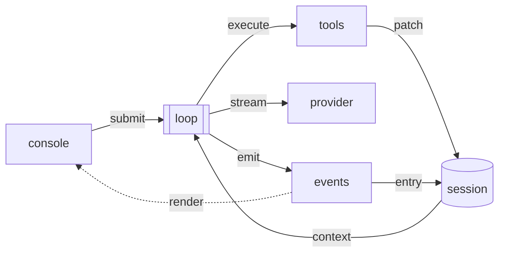

# Architecture

How the parts fit. The differences from Pi are in
[differences.md](differences.md); what each layer may depend on is in
[layers.md](layers.md).

## The two rings

- **Control ring** `console -> loop -> events -> console`: who is watching the
  agent work.
- **Memory ring** `loop -> tools -> session <- events`, then `session -> loop`:
  what changed, what was recorded, what is read next time.

An architecture diagram of an agent with no ring in it is almost always wrong,
because the job is exactly "look, change, record, look again".

## The memory ring

Entries `e1` and `e2` are conversation; `e3` executed a tool and is the only
entry carrying a reverse patch. `e4` is a second branch under the same parent.

## The four rules

**1. Only entries that changed something outside the session carry a reverse
patch.** Conversational entries carry none. If every entry had to carry one,
rollback would start depending on the assumption that an empty patch is
harmless.

**2. Rollback is path-scoped, never entry-scoped.** "Undo this step" always
means "undo the last write on the active path". Otherwise a parallel branch
forces the question "does that patch still apply here", which has no good
answer.

**3. Compaction attaches to the read side only.** `rebuild` is its only
consumer. The tree keeps every node. Implemented as "write a summary and delete
the old entries", the tree and the patches stop agreeing — this is the one thing
the memory diagram is warning about.

**4. The model never emits positions.** Tools take an intent; a locator resolves
it to a range; the edit is bounded to that range. This is the one place where
PEARL does not follow Pi, and it must be stated in the README rather than buried
here.

## Drawing rules

These documents are rendered by more than one renderer, and one of them
(`pi-mermaid`, ASCII) has a defect worth writing down: a cycle that crosses a
`subgraph` boundary makes its layout fail with `Cannot read properties of null
(reading 'x')`, reported as "no ASCII variants rendered".

Measured cases:

| Shape | Result |
| --- | --- |
| cycle entirely outside subgraphs | renders |
| cycle entirely inside one subgraph | renders |
| cycle crossing a subgraph boundary | fails |
| cycle crossing a boundary, dashed edge | fails |

So: **layers get subgraphs and stay acyclic; rings get drawn without
subgraphs.** One diagram carries one claim. A diagram that needs both a boxed
hierarchy and a closed loop needs to be two diagrams.

## Related

- [differences.md](differences.md) — eight decisions and their costs
- [layers.md](layers.md) — core, adapters, product
- [glossary.md](glossary.md) — one word, one meaning
