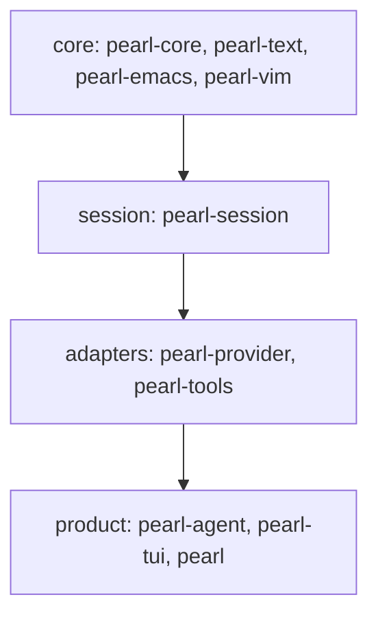

# Architecture

PEARL is a queue-centric agent development environment. The queue is the subject
the human edits; the agent loop carries each node across the wire; the session
remembers; the tools act inside a sandbox. This page names the units, the layers,
and the mechanisms.

## Units

| Crate | Layer | Responsibility |
|-------|-------|----------------|
| `pearl-core` | core | The task queue: tree data, node state machine, scheduler. The moat. |
| `pearl-text` | core | The words a human is writing: a character buffer with a caret, a mark and an undo stack, and the `Key`/`Command`/`KeyMap` vocabulary an editor speaks. No terminal. |
| `pearl-emacs` | core | Emacs's editing keys over a `pearl-text` buffer, as a state machine whose table the host may rewrite. |
| `pearl-vim` | core | Vim's Normal, Insert and Visual modes over a `pearl-text` buffer, with the same host-owned tables. |
| `pearl-session` | session | Append-only JSONL log; compaction as a projection. |
| `pearl-provider` | adapters | One provider interface over an OpenAI-compatible wire; DeepSeek first. |
| `pearl-tools` | adapters | Read, anchored revertible edit, write; the per-OS sandbox; the workspace baseline and the copy a fan-out gives each child. |
| `pearl-agent` | product | The loop: dispatch, call, drain steering, persist. |
| `pearl-tui` | product | The single-focus flat view: badges for awareness, a cursor for attention, the focused task's report below it, naming the act while it runs. |
| `pearl` | product | The command line: shape a queue, run it, watch it flow. |

## Layers

A `use` may point only downward; `config/ci.toml` declares the order and the
`layer-order` check enforces it.

## Mechanisms

### The queue is a tree in data, a flat list in view

The data is a tree: a task has subtasks, a subtask may fan out to subagents. The
view is always a single-focus flat list at the current level — narrow to a
subtree, drill in and out. Parallelism is shown as status badges you scan;
attention is the one cursor. The human edits a flat list and navigates, never the
tree directly (ADR 11).

Nesting is a decomposition, so the scheduler is depth-first: a node's unsettled
children run before the node itself, and the node's first request carries what
each settled child found (`<title>: <result>`, a failure included). A held child
holds its whole subtree — the human paused that work, and a detail of it is still
that work. A failed child does not: the parent reads the failure and decides,
rather than being stranded by a part that could not be done. `n` nests a part
under the focused task.

Below the list is the report of the focused task: its reply, or its failure
reason, or — while it runs — the act it is on, or `no report yet` if it has not
started. The loop calls `queue.note(id, act)` before it asks the model and before
each tool call, naming the tool and the path or command it touches; a note is
presentation, so a node that has been cancelled refuses it and the work goes on. The list takes the rows its tasks need up to half the
surface and the report takes the rest, showing the tail so the newest line is the
one in front of the eye. Reading is not a mode you enter — the queue is what the
attention rests on while the agent generates, and the report is what it reads
while shaping the next task.

A key that does not apply is refused by the queue, and the surface shows the
reason on a line above the keys: `pause: this task is done, needs queued or
running`. The message speaks of the state, not the id — the id is a handle
for the program, while the state is what the badge on the screen already says.
A refused placement puts the request back in the hand, so a rejected move never
swallows what the human typed. The notice clears on the next action that works,
or on `␛`.

### Thinking is kept, not replayed

An endpoint that thinks sends the thinking beside the answer
(`reasoning_content`). It is recorded in the log under its own role and kept on
the node, and it is excluded from both the next request and the transcript a
fold reads: thinking is not a turn the model had, an endpoint that returns it
rejects it as input, and folding it forward would carry the scratch work into
every later context at full price. On screen it is folded away by default —
the answer is what the human came for — and `T` opens it, dimmer than the
answer and labelled, reading before it.

### The log is replayed as the conversation it recorded

Every request is built from the log, so a resumed session is the same
conversation and not a summary of one. That only holds if the log records what
the request carried: an assistant turn that asks for tools writes the calls it
asked for, and each tool turn writes the id it answers. Without those, a replay
is a conversation with a question left unanswered -- which is exactly what
DeepSeek answered, `messages[84]: missing field 'tool_call_id'`, on a task whose
history held tool calls from an earlier one. Turns written before the ids were
recorded have neither, and they are left out of the replay rather than sent
bare: a tool result that names no call is not a turn the model can answer.

### A launch begins a conversation

The file is every run in a directory; a request is one conversation. Coming back
to a directory carries on with it, so the default launch writes no mark: the
model reads the turns the last run left off and the human gets their list back.
`--fresh` is the launch that appends the mark, and the view starts after it —
starting over is a thing a person says on purpose, not the shape of a new
window. The log keeps every run either way, which is what makes the file the
record of the directory rather than this process's scratch. A fold, an
aside and the cost estimate all read that view, so they are in one conversation
with the request. A log written before the mark existed has none, and is the
conversation it holds (ADR 23).

### Both windows scroll, and the key says which

Each window has a line motion, a page motion and a jump to either end, and one
rule names the target: **the plain key acts on the queue, Alt acts on the
report**. Every style owes all eight, and each answers with the keys its hand
already has. `Home`/`End` and `PgUp`/`PgDn`, `Alt` for the report, belong to the
plain keyboard: those four sit outside the letters, and vim or emacs reaching
for them would be leaving the keys the style lives on. Vim has `gg`/`G` and
`Alt+gg`/`Alt+G`; emacs has `M-/` and `M-\` for the queue -- the two ends of a
file, the way nano spells them -- and `C-M-<`/`C-M->`, or the `M-<`/`M->` a
terminal that cannot send the chord answers to instead, for the report. A name
never means one window on one terminal and the other window on the next. The
plain keyboard also keeps the page and the ends it alone has, so the row it
draws says so; the other two say what they have. The legend names
the keys that are bound, not the ones that would read nicely: vim's page is
bare `f`/`b`, one name per motion, and `C-f`/`C-b` are not bound at all -- two
names for one motion, one of which the row has no room to print, is how a
legend stops being the truth. The aside moved to `/` to make room; a letter a
style needs for a motion outranks a letter that names a question. The far end of the
report is a place only the drawing can measure -- wrapping decides how many lines
there are and the frame decides how tall the pane is -- so the jump asks for the
far end and the view clamps it to the top of the first full screen. Clamped as a
distance from the end of the text instead, the window shrank as it walked back
and finished in blank pages.

A page is the reader's, not the work's. A distance from the end is the right
place for a window that follows the run: the newest line keeps being the newest
line, and a round that lands pushes the words up by one row, which is what a
reader at the bottom asked for. Past the bottom it is the wrong place -- the
window is pinned to the end of a document still being written, so paging back
through a running task moves the words out from under the eye at the speed of
the work. So the distance is carried: `report_seen` remembers how long the
document was when the human last walked back, and the rows they reached stay
the rows in front of them however many rounds land under them. The page also
belongs to the task it was chosen in, and only that task's report has those
rows: when the cursor really lands somewhere else -- a key, or a task settling
and handing the cursor on -- the pane below is a different document and it opens
where a reader starts, at its newest line. A motion key that had nowhere to go
is not a move, and does not cost the reader their place. What every style
shares is only what all three editors really share: the arrows for a line, and
`Alt` for the report. The page and the two ends come from the style's own
letters, because the keys that carry them -- `PgUp`, `Home` -- are the ones a
hand has to leave the letters to reach. Letters belong to the
style that owns them -- `j/k` and `J/K` are vim's, `C-n/p` and `C-v/M-v` are
emacs's -- because a vim letter in a plain legend is a vim key wearing the wrong
clothes. Vim adds `f`/`b` and `C-d`/`C-u` for the queue and `Alt` plus the same
keys for the report; emacs has `C-M-v/C-M-S-v`, which is `scroll-other-window`:
emacs already had the report's page as a command rather than a focus to switch
first, and down is one control byte, so that half of the pair arrives on any
terminal. On a MacBook `PgUp` is `fn+↑`, which is the plain style's honest answer.

What a style can offer is also what the terminal can send, and a legacy
terminal cannot send all of it: `Ctrl` and a letter is one control byte, so
Shift under Control has nowhere to live, and `Alt` and an arrow is an `␛`
followed by a sequence the parser reads as three separate events. `C-M-S-v`,
`C-M-<` and `Alt+Down` therefore do not exist on such a terminal, however the
code is written. So the surface asks before it offers: at startup it sends the
protocol query and a device-attributes query, waits two seconds for the answer,
and pushes the kitty encoding only if the terminal says it speaks it -- a
terminal that says no is left exactly as it was found. The flags are a stack
and are popped on both ways out, the ordinary one and a panicking frame,
because a stack left pushed is a terminal whose next program reads keys it
never asked for.

The answer is not only about encoding: it decides what the legend may name. A
terminal that answered is promised `C-M-v`/`C-M-S-v` and `C-M-<`/`C-M->`; one
that did not is promised `C-M-v`/`M-P` and `M-<`/`M->`, and the help prints
those names instead of the ones a terminal with the encoding would send. Only the report's page and ends move, because only
they needed a modifier a legacy terminal cannot carry; the queue's pairs are the
same everywhere, and `M-P` is the capital letter half of `M-n`/`M-p` -- the
report's line -- which is the rule the style already follows for a page.

Meta is a modifier, not a key. Where the encoding names modifiers, macOS's
Command key arrives as `SUPER` and Option as `ALT`, and the row answers both:
`M-` is the name the legend prints and either key is the one a hand presses.
Nothing in the key table had to learn which terminal it is in -- both bits mean
Meta, and a legacy terminal simply never sends the second one. Answering the
query says what the terminal can send, not what it is set to send: Option still
composes `π` where the terminal has not been told to treat it as a modifier, and
a Command chord the terminal keeps for a paste of its own never becomes a key.
Escape and the letter is Meta in every case.

The help is a table of keys and carries no line about the terminal. What the
terminal can send is never a thing to read there; it is spelled into the name of
a key the human can press, or it is not said at all.

A shifted key is read as the legacy encoding would have sent it. `Shift+/` is
`?` on the wire from a terminal without the encoding and `/` plus Shift from one
with it; the surface rewrites the second spelling into the first at the one
point every key passes through, because the help names keys the way the first
spelling spells them and a key printed in the help has to be a key that can be
pressed. The table holds the letters and the punctuation a US keyboard shifts,
and a key it does not know is left as the terminal spelled it rather than
guessed at -- a layout that reaches `{` by another key sends the symbol itself
and never asks.

A page is the window's own height: each pane hands back the rows it was drawn
with, and the next page key moves by that number. Measured twice -- once by the
layout and once by a count of the furniture in the event loop -- the two
disagreed by the rows the notice and the place took, so a page was not a screen
and every page repeated or skipped a few lines of the one before it. Paging the
queue carries the cursor, because the window follows the cursor -- it can never
end up outside what is on screen.

### Two rows of furniture, one at each edge

The first line leads with the name and carries what the session is and where it
stands: ` 𝗣𝗘𝗔𝗥𝗟 | deepseek/deepseek-chat (m/M) | think auto (e/E) | ctx 0k→48k
(w/W) | write:~/proj | git:main*8 | plain (\) | mem 14M`. The last line carries
the keys, actions before motions. Both start one column in from the edge and
leave the last column of the row empty, so the two rows read as a frame around
the work rather than as the terminal's own first and last line, and an input
method's composition has somewhere to land. Everything between them is the
work.

The sandbox is named as a directory, because that is what it is: `write:~/proj`
says where the work is and where writes may land in one item, and a policy that
allows nothing says `read-only` in words. `workspace-write` named a policy and
left the reader to guess which directory it meant.

`:` keeps its place beside the settings keys: `m`/`e`/`w` step a ladder and
`M`/`E`/`W` open it to choose from, and `:` is the way to name a value off it --
another house's model, a window of 90000, or `trigger`, which has no ladder.

### No pane focus: every key names its window

There is no notion of which pane is active. The cursor keys always move the
queue, the reading keys always scroll the report, and each window's rule says so
in the style in use (`j|k task · f|b screen · h|l level` over the queue,
`M-j|M-k line` over the report). Layout is a separate, direct choice --
`1` queue, `2` report, `3` both, printed once in the row because it changes
which windows exist rather than moving either one -- so no keypress has to be
interpreted against a mode the human cannot see. A cycle
(`Tab`, `C-x o`) was tried and removed: it makes the next key's meaning depend on
how many times you pressed the last one.

### One order of keys, grouped, in the row and in help

`VERBS` is the single table: **start** (a add), **look** (`1|2|3` panes, then
`v` read, which help names and the row leaves out; the style's motions live on
the windows themselves), **work** (i now, t take, r rewrite, s steer, n nest,
␠ pause, R retry, c cancel, and the two readings the same key takes elsewhere
-- `c dissolve` and `c drop`), **record** (f files, y copy, z undo), **ask** (/ btw, T reason), **set** (m/M model,
e/E effort, w/W window, `\\` keyboard, S save, `:`, q quit). `key_groups()` and
`help_groups()` both read it, so the bottom row and `?` are one order and one
membership: a key named in one and missing from the other was a bug the two
tables made possible. A row may be help-only --
`v`, `p`/`P`, `n` and the four knobs carry no words for the row.

The row is the keyboard of the task in front of the cursor; help is the list of
every key. `pearl_core::Verb` is the table both sides read when they ask whether
a verb applies: the queue builds its refusal's words from it and the row shows a
key only while `Verb::accepts` says the queue would take it, so a key the row
offers and the queue refuses is not a state two tables can drift into. A verb
whose work depends on the state is named for this state -- `s steer` / `s
answer`, `c cancel` / `c drop`, `␠ pause` / `␠ run` -- because the word is what
the human reads to know what the key will do, and a row that says "steer" over a
task that is waiting to be answered is a row that has to be decoded. The order
never changes, so an eye that learned the row keeps its place as the words move.
Help carries every verb with both words, since it is the list a human reads when
the row has already gone quiet.

`c` is the one key that carries three verbs, and the row and the key read the
same question to choose among them: `c dissolve` on a place nobody has touched,
whose parts then stand where it stood; `c cancel` on a line under way, which
stops whole the way a task does; `c drop` on a settled row, which takes it off
the list -- and a settled place takes its parts and their turns with it, because
what a place held is the place's. Where two readings would both be taken, the
one that keeps the work wins: a topic with nothing in it is dissolvable and
cancellable at once, and dissolving leaves the parts on the list.

Answering that question honestly took a fact the state cannot carry. A topic
has no lifecycle of its own -- it runs no turn, so a part in flight leaves it
`Queued` while the line is plainly under way -- and a table reading the node's
own state offered to take apart lines that had already spoken, which the queue
then refused. So the tree reads the state of the work inside a place
(`parts_started`, `state_read`) before it asks the table, and the refusal that
takes a topic apart reads the same fact from the same place: the row, the key
and the sentence the refusal says are one answer, not three.

That is the whole rule, and it also decides which keys the row leaves out:
A key that asks for words refuses at the key when the focused task cannot take
them: `s` on a finished task says what the task is instead of opening a line the
queue would empty-handed refuse on Enter, and words already being typed when a
task finishes are kept -- put down, with the refusal on the notice -- because a
sentence typed once should not have to be typed twice. `v` reads a task's request, the knobs change a number the header already prints
beside the key, and `p`/`P` are dead unless something is in the hand. `y` is in
the row beside `z`, because it acts on the focused task like every other row key
and its outcome is a line in the notice, not a finger on a dial. A key the
row never prints is one the human meets in help, which is why help carries all
of them even when the header repeats the knob's name: the header answers "what
is it now", help answers "what can I press".

While a task is in the hand the row says what is held -- `in hand: <title>` --
and how to give it back: `a` and `i` place it, and `␛` returns it to the place
it was taken from, because a lift is a move half made and a mis-tapped `t` must
not cost a row. The list keeps the hole: a dim `· <title> (in hand)` stands in
the place the row will go back into, so the move is visible while it is half
made.
and stops there. It is one line about one body of work, not a second key list
to keep in step with the first; the keys that act on it are in help with every
other key. Pause is one key, `␠` (the space bar), because hold and run are
the same question asked of two states; two letters made the human read the node
before choosing. `r` rewrites the objective in place, running or queued: moving
a task through the hand would lose both its place and the work already done on
it.

The keys that move a window are written on that window's own rule, right-
aligned: the name of what the window shows stays at the left, and the keys that
move it end the same line. `queue 1-2 of 9 ────  ⇧⇩ task · PgUp|PgDn screen ·
Home|End ends · ⇦⇨ level ──`. A space ends the name, two cells of air start
the hint, and two characters of rule close the line after it: a hint that runs
into the corner reads as a rule that was severed rather than one that ends. The
gap is two cells and not one because a rule's own glyph bleeds into the cell
beside it in most monospace fonts, so `─ ⇧⇩` is a gap the eye cannot see.

Three places write keys -- the queue's rule, the report's rule, the bottom row
-- and all three separate them with `·` and `|`, so a key met at the bottom and
the same key met on a rule are punctuated the same way. `·` divides facts; `|`
divides the keys that answer one fact (`PgUp|PgDn` reads one screen up or down,
`a|i` one place after or before), so the punctuation says which keys are
alternatives and which are different jobs. The bar and not the slash, because
the slash is a key of its own -- emacs's `M-/` is the queue's first task -- and a
separator that is also a name cannot be told from it. No space sits inside a
key either: `M-<|M->` is two keys, and `M-< / M->` is a puzzle.

Keys are ASCII and nothing else: a full-width `：` from an input method is not
`:` and is not a key, and the surface neither detects an input method nor
accepts a full-width alias. The spelling used for a count is the same one the
row and help print, so `usage` lines and help lines cannot drift apart.

A key that has a glyph is written as its glyph: `⇧⇩` for the up/down pair,
`⇦⇨` left-then-right, `⏎` for Return, `␠` for the space bar, `⌫` for Backspace,
`␛` for Escape. A name costs six cells where a glyph costs one, and the row is
the scarce line; a glyph also reads the same in both help languages, so
`⇧⇩ one task` needs no translation where `up|down one task` would. The order is
the order an arrow cluster is printed on a keyboard -- up above down, left
beside right -- so a hand that knows the keys finds the glyph where it already
looks. The rule is drawn at every width and
was empty; the row was the scarce one, and it had been spending eighty columns
on two captions that each named a window the eye was already looking at. A rule
too narrow for the whole hint keeps the name and drops the hint -- half a hint
is a key nobody presses -- and `?` still has every list with a sentence per key.
That rule decides what a hint may cost: the emacs report hint names two hands of
chords and, with `C-l` on the end of it, needed eighty-three columns -- so on an
eighty-column terminal the report's rule drew no keys at all, and a reader
without paging keys has a window that appears not to move. `C-l` is in `?` with
its sentence, where the width is the window's, and off the rule, where the width
is the terminal's.
The level keys ride on the queue's rule because the levels are the queue's
tree. The layout keys do not: they decide which windows exist, so they belong to
the surface, and the surface's own line is the row. A rule that named them would
say a key moves the queue when it moves everything.

`?` is `help_groups()`: the same order, and every row carries its sentence in
both languages. The row has room for a name; a name without its meaning is a key
nobody presses. The look group is a line per window rather than a line per
motion kind -- `queue  ⇧⇩ one task · PgUp|PgDn one screen · Home|End the first
task and the last` -- because the keys are what the eye is scanning for, and a
topic per motion made a three-fact list nine lines long. The two look keys no
window owns follow those lines: the panes key, which moves the whole surface,
and `v`, which reads a request in full. Help is where the hint's short words
get their sentence: the rule says `task`, `screen`, `ends`, and these rows say
which end is which. Keys that belong to one style only
(`C-l`) ride at the end of that style's own window line instead of opening a row
of their own. The emacs `C-x 1|2|3` chord still answers, but it is the row's
`1|2|3` under a habit's spelling, so it is printed nowhere; a key that repeats
what the style's list already says is dropped, so help is the whole list rather
than the row plus notes.

`Tab` translates the screen, and neither language is the other's shadow: the
English is written for someone who has never read this repository, the Chinese
for someone who has never read it in English. A word the project invented --
the hand, a level, steer, nest -- is explained where it is used, because a
glossary the reader has to open first is a key they never press. The two
languages are one table, not two: a row
that exists in English and not in Chinese is a key the Chinese reader never
finds, and keeping them side by side is what makes that a compile-shaped
mistake rather than a translation someone forgets. That makes the screen taller
than a terminal, so it scrolls with the same moving keys and says where it is;
any other key closes it.

m, e and w are in help and not in the row: the header prints each reading with
its key beside it, so a knob is learned where its number is, and the row stays
the queue's own verbs. Help has no readings section -- it names the keys and
what they change, never the values, because a second copy of the header is a
second place to look and a third place to disagree. The `?` key is the one row
help cannot hold, because it is the row's way in; the header says how to leave.

While a draft is open the bottom row is the draft. A legend drawn over what
the human is typing is a legend that ate their input -- which is exactly what
happened when the rows were merged, and a story caught it.

### The draft is a buffer, and the two editors edit it

A prompt holds a paragraph, not a line. `⇧⏎` breaks the line where the
terminal can send it apart from `⏎` (`M-⏎` and `C-j` are there for the ones
that cannot), a paste keeps the breaks it arrived with, and the row is drawn
with a real caret the arrows and the editor's own keys move -- not a `_` typed
into the end of the string. The keys inside the draft are the chosen style's:
emacs's `C-a`/`C-e`/`C-f`/`C-b`/`C-n`/`C-p`, `M-f`/`M-b`, `C-k`/`C-u`/`C-y`,
`C-w`/`M-w`, `C-Space` and `C-/`, and vim's Normal and Insert modes with
`h`/`j`/`k`/`l`, `0`/`$`/`w`/`b`, `x`/`dd`/`cc`/`yy`/`p`, `v` and `u`. What
all three share is small on purpose: `⏎` places the task, `Tab` leaves the
draft, `Esc` puts it down.

The editors are not the surface's: the buffer and the keys they speak live in
`pearl-text`, and the two styles are `pearl-emacs` and `pearl-vim`, each a
state machine over such a buffer (ADR 27). The surface builds each style's
table, rebinds `⏎` to `Submit` and `⇧⏎` to `Break`, and hands the key over;
the editor returns `Outcome::Host(..)` for the verbs only the form can carry
out. That table is why `⏎` places a task in vim's Normal mode too, where the
editor's own `⏎` would move a line down.

**A table can say what the terminal will not deliver.** `KeyMap::unreachable`
walks the bindings the surface will actually use and reports each one a plain
terminal folds into another key -- `C-j` arriving as `⏎`, `C-h` as `⌫`, a chord
the terminal cannot tell from the same key without `Alt` -- with the reason in
words. Nothing is dropped on the strength of it: the binding stays, because the
terminal behind the terminal may be the one that can send it. What changes is
what the surface promises: the hint names `M-⏎` where `C-j` would arrive as
`⏎`, and the help's draft row ends with the keys this terminal cannot send. A
hint is the only place the fold is invisible otherwise.

**The editor's keys are the editor's document.** `pearl-text`, `pearl-emacs` and
`pearl-vim` each carry a `help()` naming the keys they answer, in the order a
hand meets them. The `?` screen does not repeat them: it names the keys this
surface answers, and a second copy of another crate's table is a copy that goes
stale the moment that table changes -- which is exactly how a human came to ask
whether `C-k` existed at all. `KeyMap::unreachable` still reports what the
terminal folds, so a host that prints an editor row can print it truthfully.

A turn names the task it was spoken for, and a topic is read off that task's
row, so lifting a finished task onto another topic carries its turns with it
(the stamp written when the turn was recorded is only the fallback for a task
that has left the list). Joining refuses one thing: work in flight, whose next
turn is already being written.

Four rules keep that from overflowing:

- **The draft takes its rows before the panes do.** It cannot be rebuilt; the
  report is already on disk and the queue is written down. It grows one row
  per line, to `clamp(height/3, 1, 8)` and never past what the window can
  spare, then scrolls with the caret.
- **A topic's row is a topic: `▸ parser  1/2` says how many of its parts have
settled, so the human can see the line of work closing without opening it. A
row is one line tall.** A task holding a paragraph shows its first line,
  `…`, and `(v shows it all)`; the whole of it is behind `v`.
- **`Tab` is one stop, not a ring.** It takes the keys to the queue and brings
  them back to the words, so reading the report while writing costs one
  keystroke and loses nothing. There is no tabbing between the queue and the
  report: bare keys are the queue's and `Alt` is the report's, and a focus ring
  would make the two rules say different things depending on what had focus.
- **Nothing throws the words away.** `Esc` puts a draft down with the words
  kept, and a second `Esc` drops it; opening a second draft is refused with
  the notice that says where the first one is. A key that means "cancel"
  elsewhere does not delete a paragraph here. A line with no words in it is
  not a draft: opened and left, or written and taken back out letter by
  letter, it closes on that first `Esc` (or `Tab`) and the surface says
  nothing, because there is nothing to keep and nothing to come back to. A
  notice that claims words survived an empty row is a notice that teaches the
  human to stop reading notices. The question a task stopped to ask is the
  exception, because there the line itself is the thing that would be lost.

`y` hands the focused task to the terminal: its words, the notices the
environment left on it, and its answer, without the bills the report adds.
There is no system clipboard a program can write to, so the surface asks over
OSC 52; where the terminal refuses, it writes the text to a file and names the
path in the notice, because a copy that did nothing and said nothing is worse
than no copy at all.

The settings list obeys the same rule from the other side: it owns the screen,
so its own letters are the only keys that reach it, and `a` and `e` drop it
before they open a prompt. A list left standing over a prompt is a list that
swallowed every letter typed next -- `M` then `a` looked like nothing at all.
`d` keeps the list, because dropping rows is one sitting, and draws what it did
on the list's own last line, because a sentence the screen does not own is a
sentence nobody reads.

### A narrow window drops whole items, and says so

A row cut mid-word is worse than a shorter row: `ctx` without its number and
`b b` without its key look like readings and are not. Every row is a list of
whole items in importance order, fitted to the width, ending in `…` when
anything was dropped. A path shortens from the left, because the tail is what
identifies a directory.

Width is measured in columns, not characters: a title in Chinese draws two
cells per character, and a row fitted by counting characters runs past the
glass and is clipped without a mark (ADR 21). The report obeys the same rule:
its answer is wrapped in display columns, and no line leaves `report_lines`
wider than the pane, because the terminal cuts a wide character in half and
from then on the cells on the glass are not the cells the console thinks it
drew.

### The answer is drawn through its own marks

A model answers in markdown, and the report used to print the syntax of it: a
topic arrived as `### 一句话`, a list as dashes in the first column, a code
block as three backticks and a gap under them. The console owns presentation and
the session owns none (ADR 26), so the marks are read once, in
`crates/pearl-tui/src/marks.rs`, on the way to the glass: the log still holds
the model's answer and only its drawing knows the answer was written in
markdown. A topic is drawn bold and, in the first two levels, underlined with
a rule; bullets and numbers keep a hanging indent so a second row lines up under
the words; a part steps in at its own depth, badge and bill included, behind a
`↳`; inline code is underlined, `**strong**` is the weight and a third
level of topic is weight plus italic; a fence
becomes a left edge with its language named; `>` becomes an edge too; a line of
nothing but rule characters is a rule.

**What travels between lines of work is the rows, not the talk.** A topic keeps
its turns to itself, which is right while it runs and would leave a hole once
it is over; the hole is closed by the list itself. Every request carries
`Queue::digest` -- the line of work the task stands in, row by row, and every
other line of the list named and counted with its last conclusion; each
finished task's title and the first line of what it
concluded, each failed one's error, each waiting task's title, topics grouped
and a topic longer than eight parts counted rather than printed -- so a later
task knows
that "parser" happened and what it decided, without reading the dead ends that
got it there.

**The digest goes after the history, never before it.** A house that caches
automatically matches a request from its first byte and stops at the first
difference, billing what matched at a tenth. The digest is the one part of the
prompt rebuilt rather than read from the log, so placing it before the inherited
history would move every byte behind it whenever a row changed state -- which is
every round. After the history, a change to it costs the digest and the new
round's own work. `crates/pearl/tests/cache-tests.rs` compares consecutive
requests as bytes, because a story about message counts cannot fail when a field
moves.

**A wait is a number, not a spinner -- and not a new number.** Every row ends
with how long it took. A row at work ends with the same reading in the same
place, counting up; when the task ends the number stops where it stands. A
spinner is a frame, and a frame cannot be asserted on a screen or read back in
a story; a second clock in a second place is a thing the human has to learn
twice. Time spent waiting for a human is not work and does not count.

**No colour is ever named.** The palette belongs to the human's terminal, and
a named foreground is a guess about it: `Color::White` landed as grey on a theme
whose brightest white is cream, and a red badge means "link" on a theme that
uses red for links. The surface therefore draws through three styles in
`crates/pearl-tui/src/style.rs` -- `dim()` for furniture, `strong()` for
emphasis, `marked()` for the cursor's row and inline code -- each of which the
terminal derives from its own two colours, so all three are legible in a
black-and-white terminal and in one we have never seen (ADR 24). Meaning that
would have been a colour is a glyph -- `▶ ✓ ✗ ‖ ⊘` -- or the notice line's
words. The rule is held by a story that walks every cell of a busy surface and
fails if any `fg` or `bg` is not `Reset`.

Nesting is read as nesting. A quote is a column of the page rather than a way
of writing a dash, so its whole block -- list, fence and all -- is read one edge
narrower and every row it made is set behind the edge; read a line at a time, a
quoted fence would open and close inside a single row and the code would arrive
without ever having been code. An indented list item stays indented, because an
inner list drawn where its parent is drawn is one list.

A table keeps its shape or keeps its honesty. When the columns fit, the names
are drawn bold over a rule, the body under them, each column sitting where its
dashes asked (`:---` left, `:--:` centred, `---:` right), and the pipes are
dropped: a border and a cell divider cost a column each and the pane is the
scarce thing. When the columns do not fit, the table is not squeezed into a grid
that would put a number under a topic it does not belong to -- it is handed on
as the text it is, pipes and all.

Two limits are part of the decision rather than left for later. **Code does not
wrap** -- a command broken across two rows is not the command that ran, so the
right edge cuts and the cut says it cut -- and **nothing is rendered as a
picture**: a terminal has no vector engine, so a mermaid block is drawn as the
code it is, with `mermaid` named above it. A mark without its partner is printed
as the character it is; guessing at what the model meant is how a report starts
saying things the answer did not.

A task's row is the one place where the order is not left to right. The bill and
the child count are readings and get their columns first; the title is what has
a rest, so it yields and says that it did. A dropped bill cannot be asked for
again; a cut title can, with `v`, which opens the focused task's request on a
screen of its own, wrapped, with the motion the other windows have. That screen
is the rest of the sentence the row shortened -- a cut is a shortening, not a
loss. So the cut row ends with `(v shows it all)` where a few columns of title
survive it: a mark alone admits the loss without offering the remedy, and a key
nobody is told about is a key nobody presses.

The draft at the bottom wraps instead of cutting: its label (`append`,
`steer`, the model stage) stays on its first row, and what does not fit goes
on the next one, because a sentence is not a row and the end of it is where
the typing is. It is drawn in the ordinary foreground: the legend is
furniture, and the words a person is composing are not.

A draft also tells the terminal where the cursor is -- at the caret, which is
where the human is typing rather than always at the end -- and leaves the
row's last column empty. When nothing is being typed the cursor
is hidden *and parked* at the left of the bottom row, because hiding a cursor
does not move it: the terminal keeps anchoring the input method wherever the
last frame's writing left it, which after a prompt is the corner of the bottom
row, where a composition's second character wraps the row and scrolls the alt
screen. A parked cursor is a position the surface chose instead of one it
inherited. Both are for the input method, which
draws its unconfirmed spelling at the cursor and hands the surface nothing
until the spelling is confirmed: a hidden cursor gives a terminal nowhere to
anchor but the corner, and a character written past the last column wraps the
row and scrolls the surface up -- the report of "typing pinyin pushes the
content off the top" with no keystroke to blame in the event log.

Two things survive every width: `? keys` and `q quit`. A window that hides how to
leave is a window the human has to kill. `?` opens the whole legend on its own
screen, so a narrow window may hide a key but is never the only place it was
written. That screen speaks for itself: a header that says any other key
closes, a `?` row in the table saying the same, and a footer with the slice it
is showing -- the main legend's tail pushed onto the end of the table was a
third voice on a line the table needed. Height yields in the same order: the ground row goes first, then the
status row; the answer keeps its rows to the last.

### A level is a place, and the topic names it

`narrow` moves the view into a task's parts and `unnarrow` comes back out; the
level keys are `h/l` in vim, `Left/Right` in plain, `^`/`RET` in emacs. The
topic reads `queue 1-2 of 2 in "fix the parser"`, because "(narrowed)" said
that you moved without saying where to, and the way back was a key you had to
trust.

### The screen goes where the attention is

Two panes, a rule under each rather than a box around each: the sides of the
screen hold text. The list windows around the cursor and says where the window
sits in the whole (`queue 33-40 of 40`), so a long queue never hides the task
being worked. The report follows the newest line, and `PgUp`/`PgDn` hold it back
to read; moving the cursor resumes following, because a new task's answer should
not arrive behind a scroll offset from the last one. The cursor is the
attention, so the queue moves it and never the other way round: `a` and `i` put
it on the task they place, a focused task that settles hands it to the next
unsettled task below, the last one keeps it so its answer stays readable, and a
human who walked back to a finished task keeps it there. `Tab` cycles split → report
→ queue, which is the switch between watching the model and reviewing the work.

### Selection is the terminal's

Pearl does not take the mouse. Selection, the scrollback it reaches into,
double-click for a word and the rectangle mode some terminals have are the
terminal's own, and none of them can be reproduced inside an alternate screen
that only knows the rows it drew. A drag that leaves the window takes the
scrollback above it with it -- the build log and the command that started the
run -- because that is what the terminal's screen holds; the alternative was
claiming the left button and reimplementing selection, which stops at the
window's edge and which the terminal still does better.

### Taking a write back is the human's move

The ledger of takeable writes (`pearl_tools::Ops`) is a handle like the queue
and the settings: the runner records what each op touched, and `z` at the
keyboard takes the newest one back without waiting for the loop or asking the
model. A shell op records its whole-tree before-image, whose bytes wait on disk
under content-derived names; `edit` and `write` record
the one file as before and after bytes, so taking an edit back writes one file
and leaves every other path alone. `Ops` owns the id counter, so two tasks on
one ledger never share an op id.

A file is undone only while it still holds the bytes that op wrote. When it does
not -- the human, or a later op, has written over it -- `z` refuses with the
path and the reason and leaves the file as it is: an undo may not take back work
that came after it (ADR 28). The undo names the op it took back, so the human can
match it against what they saw rather than trust a number.

Each op records the task it served, so `f` answers "what did this row touch?"
from the same ledger: the writes it is on the hook for, oldest first, then the
count of commands it ran -- a command may have written anywhere, and says so
rather than pretending the list is complete. A row that touched nothing says
that, which is also an answer.

### A question stops the task and shows on its row

An agent that cannot ask guesses, and guessing is paid for twice: in the money
spent on the wrong work and in the files it writes. So a task may call `ask`
with one question; the row goes to `AwaitingInput`, keeps the question beside
its title, and the runner waits -- not by polling the model, but on the node's
own state. The answer arrives at the keyboard: the line opens itself for the
first waiting task the frame finds (`answer: ` with the question on the notice
line), because a run that stops and says nothing leaves a still screen and no
reason to press `s`; a draft being typed, a request in hand, or a question
already put down keeps the line where it is, and `s` on a waiting row still
opens it. The words are written as the human's next message, and the runner's
wait ends the moment the state is `Running` again. If the human takes the row away, or the
task ends while the question stands, the wait ends with a tool result that says
so instead of hanging: a question nobody can answer is not a reason to spin.

### The list is a projection of the log

The queue is written into the same session file as the conversation: a `Queue`
entry carries the serialized tree whenever the list changes, and a launch puts
the newest one *of its own conversation* back -- the newest before its launch
mark belongs to a run `--fresh` put behind it -- with every unfinished task
held, so coming back to a directory shows the work that was left and spends
nothing until the human says which row goes on (ADR 29). No request ever reads those entries -- `replay()`
and `view()` drop them before budgeting -- so the list costs the model nothing.

The snapshot carries the list and not the transcript: a row's answer, its
thinking and its rounds are the entries written when they happened, and a
resume reads them back from there, stamped with the task that spoke them
(ADR 33). A child's report is read from the child's own log beside this one.
What counts as a change is the list -- `Queue::standing`, the tree without an
activity line or a running total -- so a night of asking the model writes a
handful of snapshots rather than one per round. A snapshot from an older window
still carries its answers, and what it carries wins.
The ledger of takeable writes is not restored: after coming back, `z` has no
before-images and says so.

One window per directory is what makes that safe. The session file carries a
claim beside it (`pearl-session.lock`), taken exclusively when the log opens and
released when the last handle closes; a second window is told the directory is
taken and which file to remove if it is not. A claim whose process is gone --
a window closed by its terminal manager, a process killed -- is cleared on the
next open, because a lock that outlives its holder turns one crash into a
directory nobody can open again. Without the claim a default launch
would let two processes restore the same list and run the same tasks twice,
paying twice.

### The window is visible while it fills

A fold that happens silently is indistinguishable from a model that forgot. The
runner reports each request's billed prompt tokens and each fold into a `Gauge`
handle; the surface reads the same handle, so the status row shows the fill
against the configured window and how many times history has folded. The
reading is the provider's own token count, not an estimate.

The status row answers "how full", and the report answers "what happened to this
task". So a fold also leaves a line on the task it folded for: `noted` sits
above the answer with `history: summarized 12 older entries, 26.4k -> 7.1k, to
fit the window` -- once per fold, with the size before and after, because a
count alone says how often the fold happened and never whether it was worth
doing.
The count in the header is the session's, and the line is the task's; a human
reading a report after the work stopped can see why the answer quotes its last
turn and not its first. The line outlives the activity note, which the answer
replaces -- an answer shaped by a fold is not the whole record without it.

### The ground is named on its own row

The knobs and the bill share a row; the ground gets one of its own:
`~/Projects/rust/pearl  git:main*8  sandbox:workspace-write`. Three facts whose
absence is noticed only after the files have changed -- which directory the
writes land in, what the sandbox allows there, which branch a commit would join.

The branch is read from `.git/HEAD` (following a `.git` file into a worktree),
because a subprocess per frame is a cost rather than a reading; the dirty count
asks `git status --porcelain` at most every two seconds and counts untracked
files, since a file the agent created is a change to the tree. An unasked count
shows `*?`, never a clean tree. `RUNNER_POLICY` is declared once in the binary
crate and used by both the runner and the surface, so the row names the
confinement actually in force rather than a second opinion about it.

### One bill, three readings

`Cost` is tokens up, tokens down, elapsed milliseconds and a turn count, from
the provider's own usage and the clock around the request. The same ledger is
read at three scopes, so the readings add up instead of being three opinions:

- a **turn** is itemised in the report, and the line names the round's work
  beside its bill (`turn 2  read crates/x.rs  ↑1.2k ↓340 0.4s`): every call it
  made, each with the argument that says what it was for, or `answer` when it
  was the last one. A round that asked for two tools said `read, bash`, which
  is a list of names and not an account of the round -- two reads and one read
  are different rounds with the same word, and the path is the only thing that
  says what was looked at. Past two calls the note counts its tail (`+2`)
  rather than running off the edge of the pane. A bill with no subject says a
  round was expensive and not what it bought, so the work comes first and the
  numbers follow it;
- a **task** carries its total on its queue row, and a child's turns are charged
  to the child -- a parent is not billed twice for work it delegated;
- the **session** total sits on the status line, and includes asides: a side
  question enters no task and no log, but it is still billed.

An empty cost is not rendered. `↑0 ↓0 0.0s` on a task that has not run is a
claim, not a reading.

### The footprint is the kernel's figure

`mem 14M` on the status line is resident memory read from the OS each frame:
`/proc/self/status` on Linux, `MACH_TASK_BASIC_INFO` on macOS,
`GetProcessMemoryInfo` on Windows. No estimate stands in for a number the kernel
already has, and no dependency is taken for one reading. macOS needs
`MACH_TASK_BASIC_INFO` rather than `TASK_BASIC_INFO_64`: the latter answers with
the 32-bit layout and a success code, so every field after the first is garbage
while the call looks like it worked.

### The key is resolved at use, and it can name its house

Two sources, in order: the environment variable of the house the endpoint
belongs to (`DEEPSEEK_API_KEY`, `OPENAI_API_KEY`, derived from the host), then an
authinfo line whose `machine` matches that host -- `~/.authinfo`, or
`~/.authinfo.gpg` decrypted by the user's own `gpg --quiet --batch --decrypt`
when only the encrypted form exists (ADR 20). A `.gpg` file that cannot be
decrypted -- gpg missing, a refusal, a pinentry the ten-second wait cuts off --
is no key, never a fallback to reading the bytes as text, and the decrypted
text is parsed and never logged. The environment wins
because a key set for this run is a deliberate override of a file that serves
every tool on the machine (ADR 17). Nothing is stored, and nothing is read
early: `Houses` is the provider the loop holds, and it asks where the request is
going and who is paying each time it makes one. A client built at launch could
not follow a model chosen at the keyboard -- it would send the new model's name
to the old model's server. No other house's key is borrowed: a wrong key is
worse than no key, because it is sent.

No key is a valid answer. A local server that wants none is asked with no
Authorization header at all, and the surface starts either way -- refusing to
run until a key appears would make every local endpoint second-class.

An authinfo line names the machine, so it can also name the house, and the
status line says `deepseek/deepseek-chat` rather than a bare model. A known
house seeds the candidate list with the models it serves; an unknown one seeds
nothing, because guessing a name for someone's local endpoint replaces a
working choice with a broken one. Either way the list is the human's to edit.

`M` opens the rows however many there are: arrows move, `RET` chooses, and
`a`, `e` and `d` add, edit and drop from where the rows already are -- `e` opens
the prompt carrying the row as it stands, so editing starts from the row rather
than from a blank line and a grammar to remember. A row whose key cannot be
found says `no key`; it is still choosable, because a local endpoint needs
none, but it must not look like one that can be paid for. The header names the
house of the chosen candidate, not the house of the launch credential.

### Three keyboards, one product

Motion is a style; action is the product. `\` cycles plain, vim and emacs, and
only motion changes: `a`, `i`, `s`, `n`, `t`, `r`, `z`, `/`, `T`, `m`, `e`, `w`,
`S`, space and `:` mean the same thing in all three, so learning a second style
is learning four keys rather than a second tool.

- **plain**: arrows move, Left/Right change level, Alt+Up/Down read back,
  `PgUp`/`PgDn` and `Home`/`End` reach a screen and an end. Those two keys are
  fn-combinations on a MacBook, which is exactly why the other two styles never
  ask for them: the plain keyboard is the one that has a page key on it.
- **vim**: `j`/`k`, `h`/`l` for levels, `f`/`b` and `C-d`/`C-u` to read,
  `gg`/`G` for the ends. `h` is a level here, so pausing is `space` in every
  style: a key that moves in one keyboard and pauses in another is the one
  collision the table cannot absorb.
- **emacs**: `C-n`/`C-p`, `M-v`/`C-v` to read, `M-/`/`M-\` for the queue's
  ends and `M-<`/`M->` for the report's, `^` up a level (dired's own key),
  `C-x o` for the other window, `C-l` recentre, and `C-g` quits whatever is
  pending -- inside a draft it puts the words down, as `Esc` does.

The hints on the two rules are written from the style, because a style whose
keys are not on screen is a style nobody can use.

**A paste is text, not keystrokes.** The terminal is asked for bracketed
paste, and the text arrives as one event, with the breaks it was written with:
a draft holds a paragraph, and a tab becomes one space because there is no
column in a line for it to mean anything. Read as keys instead, a pasted
paragraph is a Return per line: the first line places a task, the rest of the
paragraph is read as commands, and the surface ends up several prompts deep
with tasks nobody wrote. With no prompt open a
paste is the answer to nothing, so it places nothing.

**A chord is not a letter.** The action table is bare keys, and a terminal that
speaks the kitty encoding sends `C-M-v` as one event carrying `Char('v')`. Read
as the letter it looks like, that event opened the request screen, and through
`\` it changed the keyboard itself, after which every keystroke went into a
prompt nobody had asked for. So the action table answers nothing while Control
or Alt is held -- `C-c` is the one chord the surface answers, and it is answered
before any mode is consulted; inside a draft it puts the words down rather than
deleting them, because a paragraph is not something a stray chord gets to
throw away, and it quits only when nothing is open -- and a prompt takes text
only while neither is held. `C-M-v` in the emacs keyboard still pages the
report: motion is asked first, and it is the layer that names its own chords.

### The status bar is the control panel

Every reading that has a key names it beside itself: `deepseek-reasoner (M) |
think low (e/E) | ctx 48k→96k (w/W) | cache 90% | summarized 1x`. The climb is
stated with the point it turns at, not with the window's ceiling: what a person
watching a night of work acts on is how near the page is to turning, and the
ceiling is a number nothing they press is measured against. The row has one
width for both, so the ceiling lives where it is asked for -- the `w`/`W`
chooser, and `:window`. One rule for all three settings: the lowercase letter steps to the
next value, the uppercase letter opens the values to choose between. No count
decides which one a press means -- a rule that changes with the length of a
list is a rule the human has to test before every press. `:` still takes a
typed line for a value off a ladder. The window ladder runs 16k, 32k, 64k, 128k, 200k, 256k, 400k, 1M: it
names the windows models actually have rather than stopping at the smallest
house's, and a fold threshold is a share of whichever one is chosen. `S` keeps every knob at once, in `~/.pearl/config` (or `PEARL_CONFIG`),
written in the same lines the `:` prompt takes -- a second grammar for the same
knobs is how a file and a prompt disagree.

### Configuration is a live edit

`Settings` is a handle like the queue: the surface, the runner and the aside
hold the same one. `:` opens a line and `model`, `effort`, `window`, `trigger`,
`rounds` or `fold` changes it; the next request reads the new values, so nothing is
restarted and no file is edited. The models to choose between are the human's list, not a
table in the code: `models` numbers it, `add <endpoint> <model>` appends a row,
`edit <n> <endpoint> <model>` rewrites one, `remove <n>` drops it and `choose
<n>` takes it. A candidate is an endpoint and a model id and nothing else --
the house is read off the endpoint, because a second field that has to agree
with the first is a field that will disagree with it, and the key is not a
field at all. Two servers on one machine are two rows: a host that names no
house carries its port, so `localhost:11434/qwen3` and `localhost:8080/qwen3`
are distinguishable. `-` stands for the endpoint the process was launched
against, which is what a row written before endpoints were choices means; a
model id on its own says the same thing in one fewer word, and a word carrying
`://` is read as an address, so half a line is still refused rather than filed
as a model. A line that does not parse changes nothing and says why.

`M` opens that list and `a` and `e` write a row in two stages, because a row
has two fields and they are not the same kind of thing. The address comes
first, from the ones already in use -- every distinct endpoint in the list,
then the launch endpoint, then the bases the major houses publish -- plus a
last row for one that is not there yet; the id comes second, typed by hand
against the address just chosen. The address stage is titled by the row it is
rewriting, because that row is behind the list and nothing else on the screen
says whose address is being moved. An address is reused and an id is not, so
the address is the one that gets a list. The offers are the rows the config
holds: an address joins the list only when a complete pair is committed, so
one typed and then left is never on the next list, and one saved yesterday is
on it today. The published bases are a fixed list rather than a fetched one,
and
each is a promise that requests to it work, so an entry goes in only when the
house's own documentation names it and the address answers a request without a
key -- 401 or 403, which is "who are you", not "no such path". The launch row
names the address it sends to and the published list does not name it again:
two rows for one place is a list arguing with itself, and the human has no way
to see they are the same.

A row reads as the house, then the address, because the house is what the eye
knows: `open.bigmodel.cn/api/paas/v4` is a host, and `bigmodel` is the word the
header calls the chosen row and the key is filed under. It is read off the
address rather than stored beside it, so the column cannot disagree with the
derivation it shows, and a host that belongs to no company reads `local`. The
launch row shows its address and adds that it is the launch, and the last row
says the act -- `enter an address of your own` -- because it is not an address
and must not look like one. Neither stage asks the human for the row number,
the house or the key: the cursor says which row, and the address supplies the
house the list prints and the host the key is looked up under. The notice
names what the pair resolved to, so a row typed as
`https://api.openai.com/v1` + `gpt-4o` is answered by `openai/gpt-4o`: the one
thing the human did not type is the one thing they are shown.

A notice is the answer to the last act, and the next key ends it. A line that
waits for a particular key to clear it -- Esc, or the close of a list -- says
the wrong thing about every act in between, and one of them is the act the
human just did. The one place a remark outlives its key is inside an open
list, where it stands until the list is used again.

The address is normalised on the way in and checked for the protocol it names.
A base that already carries `/chat/completions` loses it -- the provider
appends that itself, and a copied quickstart URL would otherwise ask for it
twice -- and a path that belongs to somebody else's API is refused before the
id is asked for, in a sentence that names the address that would have worked:
`/messages` is Anthropic's, `:generateContent` is Google's, `/api/chat` is
Ollama's, and a bare `/completions` is the legacy one. A 404 four turns later
reads as pearl being broken; the same fact at the moment the address is typed
is a correction.

Thinking is one ladder of intent -- `auto` and then `off`, `minimal`, `low`,
`medium`, `high`, `xhigh`, `max` -- and a dialect per house that says which of
those it can put on the wire and how. The ladder is one vocabulary, not one per
endpoint: a rung means the same strength wherever it lands, which is what lets
the same menu stand in front of every house. `auto` sends nothing and lets the endpoint decide; `off` is a
rung, not the absence of one, because "do not think" and "you decide" are
different requests. The dialect is read off the house and can be stated by
hand with `dialect <name>`; DeepSeek has no rungs at all, since its model id
decides, so `e` there says why it did not move rather than moving to a word
the endpoint would drop. A rung the dialect cannot express is refused with
the list of ones it can, never quietly downgraded: a setting the endpoint
cannot honour is a setting that lies. The list `E` opens shows the whole
ladder and marks the rows this endpoint cannot say, so a house with none shows
every rung as unspoken rather than showing a shorter menu -- a menu that
changes shape with the endpoint teaches nothing about the endpoint, and
`xhigh` is on it because a word one house invented is still a strength the
others can be asked for. The translation to fields
lives in one place, `pearl-provider`'s `wire`, so the ladder and the request
cannot disagree about what a word means. A house that wants a number rather
than a word -- Anthropic's `budget_tokens`, Qwen's `thinking_budget` -- gets
one derived from the same rung, so a number house can say the whole ladder,
under a ceiling taken from the window, with `max_tokens` sent so the budget
has something to sit under. The arithmetic is ours, so a refusal for it would
be the ladder blaming the endpoint for our own sum. The saved config states the dialect first, because a
file read top to bottom has to know it before it meets a rung.

A refusal is the endpoint's own words, kept: a non-2xx answer carries its
status and its `error.message` rather than becoming "the response had no
usable choice", which is true of a refusal and tells the human nothing to
change. When that message names a thinking field, the endpoint has answered a
narrower question than the dialect asks -- not "can you speak this dialect"
but "will you take this word" -- so the answer is kept at the width the
sentence actually names. A message about a value files the rung in force; a
message about the parameter itself ("unsupported parameter", "unrecognised")
files every rung the dialect has, because an endpoint that does not know the
field will say the same thing about the next four words. The narrow reading is
the default for a sentence nobody anticipated: being wrong narrowly costs one
more round trip, being wrong widely throws away a setting the endpoint would
have honoured. Either way `effort` returns to `auto` and the task asks once
more without the field -- one correction per task, since an endpoint that
refuses the retry is refusing something else and looping would spend the
human's money finding that out.

What is filed is a mark, not a deletion. `E` still lists the refused rung,
with the reason beside it, and `e` steps over it -- a row that vanished would
hide the only fact this screen knows and the human does not. Refusals are keyed
by the address that answered -- `-` for the launch endpoint -- because the
dialect is guessed from the house but a 400 is one machine talking, and two
gateways under one house may disagree about a word. A word DeepSeek would not
take is therefore still offered against Qwen; a
refusal recorded once is written to the config as `refused <address> <rung>`,
because the next session should not have to earn it with the same 400, and
`refused clear` is the one way back when the endpoint starts taking it. The
header names a dialect that was stated or learned, and stays quiet about one
that is merely the house's own.

Both entry points build their knobs the same way: the house's models seeded,
the kept file read over them, the result handed to the agent. A one-shot run
that built its own defaults would answer a different question from the one
the human configured, and the file is the only statement of what that was. The
window and the fold fraction live here rather than in `CompactionPolicy`, which
keeps only what a fold retains — one source of truth, and the fold's own budget
is scaled to the window in force so a small window can still reclaim room. A
status line above the keys names the model, the effort and the fold point.

The default fraction is 0.375, so a 128k window folds at 48k. The fold point is
a price and not a safety margin: every round of the climb to it is billed again
from the start of the conversation, so the night costs the mean of the sawtooth
rather than its peak (ADR 37).

`rounds <n>` is how many rounds of tools one stretch of a row is worth, 64 by
default and 1 to 1000. It was a bound on the prompt when the round count was the
only thing between a task and a full window; folding bounds the prompt now, so
the count is about the human's patience and the bill. A row that spends its
stretch stops where it stands and names the number the human set, not one the
loop chose, with the key that buys another.

`fold <model>` names a different model for the summary alone: writing a page of
prose from a transcript is not what the working model is priced for. `fold auto`
returns it to the working one. The id is asked of the endpoint in force, so a
model listed on another house is refused where it is typed rather than as a 404
that leaves the history unfolded. When one is named the status line says
`fold <model>`, because a window that names one model while the session pays two
is a window that lies about the price.

### The node state machine

A node is `Queued`, `Running`, `AwaitingInput`, `Paused`, `Done`, `Failed`, or
`Cancelled`. `Running` is composite: it executes, drains steering at a boundary,
and waits on its children. Two hard guarantees: steering injects at a boundary,
never mid-token; a paused node's frame and the queue are persisted outside the
model context, so "do not forget" is a system guarantee. A parent finishes only
when every child has settled.

A row spends at most 64 rounds — a model call and the tools it asked for —
without an answer. Then it stops where it stands in `Paused`, with the count and
the key that buys another 64 in its own words, because the loop needs a bound
and the human needs a bound they can pass: the work on the row up to there is
real, and failing it would throw that away with a reason only the log could
read.

### Editing the queue: take and place

An unexecuted node is not edited in place. It is **taken** into the hand as a
`Request` (`take(id)`), the human edits that value, and **places** it back
(`place(request, position)`). One model covers append, insert and reorder: a
`Request` is a task not yet placed, carrying a `Form` (`Task` or
`Steering`) and an optional target; a `Position` says where it lands — `Last` at
the end (what append means), `After` the focus (the deliberate move a taken
request is placed with), `Now` before everything, or `Into(id)` as a steering
hint. Placing looks at what was placed: `a` and `i` move the cursor to the new
task, `n` leaves it on the whole the part belongs to. Placing also refuses a
title with nothing in it (`QueueError::Empty`), because a row with no text costs
a request with no question in it and reads as nothing on the next run: Enter
on an empty prompt keeps the queue as it was and says what is missing. There is
no separate draft type; the request is the disassembled node. The hand holds one
request at a time, so attention stays single-thread (ADR 11). `t` takes, `Enter`
edits what is held, `p`/`P` place it.

Moving a task is not the only way to change its words. `r` rewrites the
objective where it stands, queued or running: the node keeps its place in the
list and its completed work, and a running loop is told to re-plan around the
new objective at its next boundary. Taking it into the hand instead would move
it and throw away what it had already done, which is the wrong price for a
change of words.

### The runtime operations

- **Follow-up** appends a new node; **steering** annotates a queued or running
  node and drains at the turn boundary (ADR 10).
- **Preempt** pushes an urgent node, saving the running node's frame and pausing
  it. **Hold** pauses without an urgent successor; **run** puts a paused node
  back in line (`Queued`, frame kept) — only the runner dispatches, so a row
  marked `Running` by anyone else is one the runner never looks at again.
- **Rewrite** retitles a node in place -- a queued node's words are the whole
  objective, a live one is also steered; **cancel** stops one, and on a settled
  one it forgets the row; **retry** queues a finished one again.
- An agent confirmation is a state (`AwaitingInput`), not a new task, so it never
  swallows queued work.

### One queue, two holders

The surface and the runner are the same session. `Queue` is a handle over one
tree behind a mutex, so the surface edits what the runner drains and neither
holds a copy (ADR 17). `Agent::serve(stop)` runs what is placed and waits on a
`watch` channel when nothing is, so an empty queue is a state and not the end of
the process. A provider that refuses fails the node, not the session: the queue's
other work still runs, and the failed badge is what the human retries.

### Subagents are derived sessions

The model fans a running node out by calling `subagent` with a list of titles;
the loop performs it, because it needs the queue and the pool. Each child gets a
derived session (`parent-{child}.jsonl`) and its own copy of the workspace at
`../.pearl-children/<child>/` — beside the workspace, never inside it, since a
copy within its own source copies itself and the parent's baseline would then
snapshot the children's work as the human's. `run_children` runs them at the same
time (ADR 15), and what each one found returns as the tool result, so the parent
reads its children's answers in the same turn. A
child settles as a queue event, and the parent finishes only when every child has
settled — the nesting invariant. The human keeps one focus while the children
run. Because each child writes into its own copy, one child's revert cannot
reach another's tree, and no scheduling rule has to be trusted to keep them
apart. What a child produces returns as text; merging its tree back into the
parent's is a later promise.

### Compaction is a projection

The session keeps the full append-only log. `view(entries)` hides what a later
summary covers; `split` chooses the cut — the largest tail the budget leaves,
never below three entries, snapped forward to a `User` turn so a tool result is
never separated from the call it answers; `project` asks the model to write the
summary and returns it with the range to record. The loop folds at three
quarters of the window, appends the summary with its coverage (ADR 16), and
learns its estimator from each completion's billed `prompt_tokens`. The source
is untouched, and the queue lives outside the model context, so no projection
can drop it (ADR 7).

A second projection is cheaper and runs every round: `fold_results` shortens
the older tool outputs on the wire to `[folded: N bytes, L lines]` plus the line
they opened with, keeping the newest twelve whole. It asks no model and writes
no summary, because nothing is lost — the log holds every output, and the model
can run the command again. The line moves in whole groups of sixteen outputs
rather than every round, so the bytes before it are identical on two
consecutive requests and a prefix cache still recognises them (ADR 36). The
window is measured against what the request carries, not against the log.

### Edits are anchored and revertible

`Workspace::edit` requires a unique text anchor, snapshots the file before the
first change, and `revert` restores the prior state. Paths are confined to the
root (ADR 8).

### Shell ops are revertible by baseline

Every `bash` op captures a `Baseline` of the workspace before it runs and
reports its op id; `revert_bash(op)` restores changed and deleted files and
removes created ones. The bytes wait in a content-addressed store in the
system's temporary directory, shared by the whole ledger, so an unchanged file
is written once for the run and each op keeps a name and a length per path
(ADR 32). A file that has not changed since it was last read is recognised by
its modification time and length rather than read again, and a mark stamped
inside the current second is never trusted: 90 ms cold, 1.9 ms warm for the 275
files of this repository (ADR 35). Pearl's own state -- the session log, its claim, a child's log, the
per-op scratch -- is named where it is opened and left out of every capture and
every copy, so an undo cannot rewind the conversation that recorded it (ADR 31).
The shell is the platform's own -- `sh -c` on Unix,
`cmd /C` on Windows, with the command carried in a batch file where cmd's own
quoting rules make argv unusable (ADR 19). The command's output is captured
through a per-op file and reaches the model, so the compiler is the feedback
channel (ADR 13). A long output is cut at the last whole character its byte
budget affords, never inside one.

### An aside is not work

A side question (`b` on the surface, `Agent::btw` in the loop) is answered
against the session read-only and returns to the surface without entering the
queue or the log. It is a single loose node with a three-state life, held
outside the tree until dismissed (ADR 14).

### The sandbox is the OS's own primitive

`Policy` is `ReadOnly`, `WorkspaceWrite`, or `Full`. macOS uses Seatbelt
(`sandbox-exec`); Linux uses Landlock; Windows uses an AppContainer profile inside
a Job Object with kill-on-close (ADR 5). The boundary is a copy, not a cage.

**A child is given no terminal.** The surface owns every cell it draws, and its
model of the screen is what it last put there, so anything else that writes to
the terminal writes over a frame the console will leave alone until it is
cleared: half a line from a shell's complaint, a neighbour's numbers, a border
that does not come back. So a command's stdio is set by us and never inherited:
stdin is the null device, and its words go to the capture file the tool reads,
or nowhere. The capture is opened by the parent and handed over as a handle, so
a command the shell cannot parse has its complaint land in the report instead of
on the glass -- it used to land on the glass, and the report was empty.

**It is a write boundary, not a read boundary.** On macOS and Linux the confined
process may read anything the user may read: the profile allows `file-read*`, and
Landlock grants read on `/`, and Windows grants the AppContainer SID
`FILE_GENERIC_READ` on the workspace's drive root and the system drive, so one
policy means one thing everywhere (ADR 18). Writes outside the root fail with a
permission error and nothing is created; `rm` outside fails and the file survives;
outbound network is denied (a `curl` fails to resolve). So the agent can read a
file outside the workspace and quote it into the workspace or into the model's
context -- the boundary stops it changing your machine, not it seeing your
machine. The Windows read grant is an ACE on the drive's security descriptor: it
outlives the process and pearl, and a revert does not take it back.

**Writes are the workspace plus the scratch roots.** `$TMPDIR` and `/tmp`, in both
spellings where `/var` is a symlink into `/private`. An agent that cannot write a
scratch file cannot use the shell for more than one-liners: a script, a log, a
compiler's intermediate all need somewhere that is not the human's tree. The
per-session TMPDIR leaf is granted, not all of `/var/folders`, which would hand
over every other application's scratch with it. `ReadOnly` refuses scratch too.
The header names the whole boundary: `write:~/proj+tmp`.

**The ground is said once, at the start.** The header names the sandbox and
the OS enforces it, but the model was told neither, so a task could spend
dozens of rounds finding out where it may write -- paying for the discovery in
tokens and in a tree it then had to undo. The first turn of a conversation is
a `System` entry that names the root, says what the policy allows and that the
OS refuses the rest, and asks for a patch instead of a write for a file
outside. It is written once: a resumed conversation already carries it.

**Looking is a tool, not a shell command.** `read` takes `offset` and `limit`
and returns numbered lines under a budget of 2000 lines and 64 KiB, cutting any
one line at 2000 characters; the cut says how many lines are left and the offset
to continue from. It streams the file, so only the window is held. This is not
only a convenience: a shell op captures a whole-workspace baseline before it
runs (1.9 ms warm and 90 ms cold for 275 files on this repository), which a read
cannot need, and a
tool result is appended to the log and replayed into every request after it. A
session whose turns were 278 shell calls and 5 reads was paying that baseline
for `grep`, `sed` and `head`. The row names the range: `read src/x.rs:1200-1399`.

`search` is the other half of that habit: the same log held 166 `grep`
invocations. It returns `path:line:text` across the workspace, skipping `.git`
and build output, capped at 200 matches and 32 KiB with the rest counted. It
matches text, not a pattern -- a leading `^` anchors at column zero, a dot is a
dot, and anything else a regex engine owns is refused with the door that does it
(ADR 34). Finding and reading are offered to the model as the cheaper doors, and
the descriptions say why.

**The file tools keep the policy themselves.** The shell is confined by the OS;
`write` and `edit` run inside this process, so a `read-only` launch used to be
able to write anyway -- a policy the header printed and the code did not keep.
Those tools now refuse a write under `read-only`, and a path that climbs out of
the workspace root is refused with the root named, both of them leaving the
same kind of line on the task: `sandbox: a write was refused; the policy is
read-only`, `sandbox: a write was refused (outside the workspace); writes land
under ~/proj and the scratch roots`.

**A file name is taken from the workspace root.** `read`, `search`, `edit` and
`write` all say so on their door, because that is the spelling the session log,
the baseline, the undo and the report all share, and a file named twice is two
files to a reader. The model learns the other spelling anyway -- `pwd` prints
it, a compiler error prints it -- so a name from `/` is read as the file it
points at when that file is inside the workspace, and recorded as the name from
the root. A path that names something outside is refused, and the row says
`outside the workspace`, because that is the edge that was crossed; the
spelling was not wrong and the model is not told that it was.

The report's own line follows the same rule: a turn that wrote `/…/crates/x.rs`
reads `write crates/x.rs`, the way a command that opened with `cd` into the
workspace already lost its `cd`.

**A refusal is named in the report.** The OS says no in words on the command's
stderr -- `Operation not permitted`, `Permission denied`, `Read-only file
system`, `Access is denied` -- and no exit code is reserved for it. The bash tool
reads those words out of the output it already captured, and when the policy
could have been the one that said no, it records a line on the task: `sandbox: a
write was refused (Operation not permitted); writes land under ~/proj and the
scratch roots`. The model's copy of the output is untouched. Only a failed
command is read, and inside it only a line in the shell's own shape -- a
program, a path, the phrase closing the line, `sh: /etc/x: Operation not
permitted` -- because a task that `cat`s this page prints the same words and was
called a refusal once already. This is a reading of the text, not a syscall
audit, and it is one because the alternative is a `Operation not permitted` on
the glass with nothing to say what the boundary is or where it lets writes land;

Seatbelt and Landlock hand back no rule, and `(debug deny)` prints nothing on
current macOS. `Full` confines nothing, so a refusal there is the filesystem's
and is left to the command.

**The null device is writable under every policy**, with `/dev/zero`, `/dev/fd`
and the descriptor links `stdout` and `stderr`. They discard what is written or
address the child's own pipe, so the grant adds no reach; refusing them failed
`ls -la 2>/dev/null` with a message about `/dev/null` rather than about the
command, and cost a task two extra model turns (ADR 22).

The confinement is proved where it runs, not just where it compiles: four stories
spawn a real confined process and assert what it could and could not touch, and
the check suite runs them on macOS, Linux and Windows. Seatbelt matches resolved
paths, so the macOS profile names the canonical root (`/var` resolves to
`/private/var`) or a write inside the workspace would be denied.