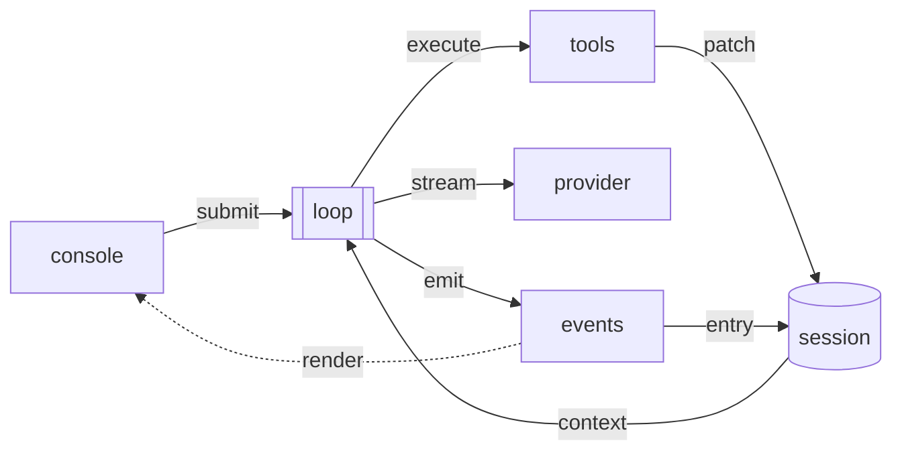
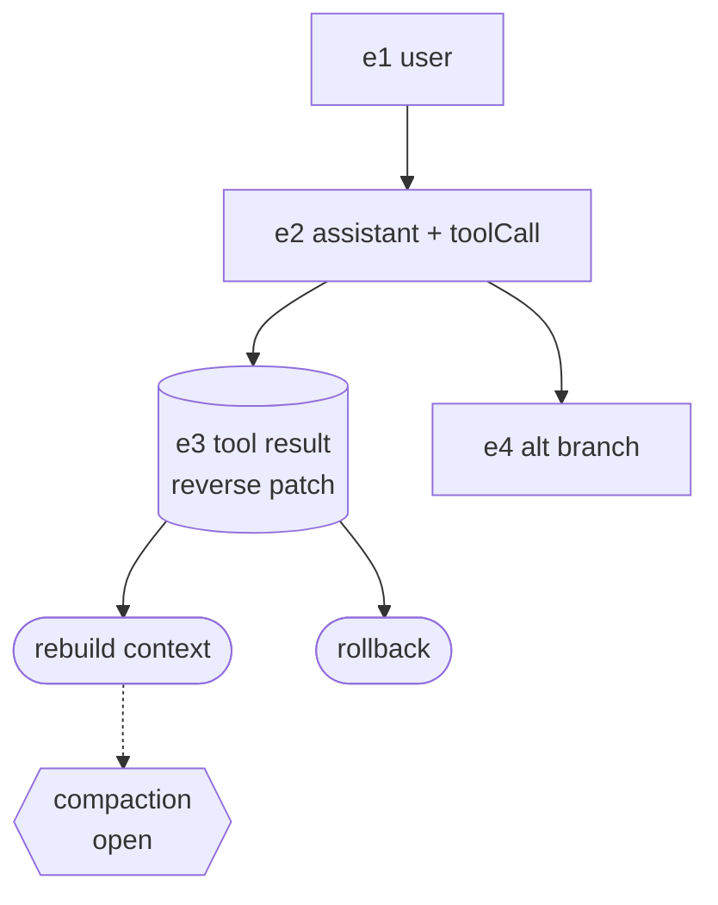

# Architecture

How the parts fit. The differences from Pi, and what each one costs, are in
[differences.md](differences.md).

## The two rings

- **Control ring** `console -> loop -> events -> console`: who is watching the
  agent work.
- **Memory ring** `loop -> tools -> session <- events`, then `session -> loop`:
  what changed, what was recorded, what is read next time.

An architecture diagram of an agent with no ring in it is almost always wrong,
because the job is exactly "look, change, record, look again".

## The memory ring

Entries `e1` and `e2` are conversation; `e3` executed a tool and is the only
entry carrying a reverse patch. `e4` is a second branch under the same parent.

## The four rules

**1. Only entries that changed something outside the session carry a reverse
patch.** Conversational entries carry none. If every entry had to carry one,
rollback would start depending on the assumption that an empty patch is
harmless.

**2. Rollback is path-scoped, never entry-scoped.** "Undo this step" always
means "undo the last write on the active path". Otherwise a parallel branch
forces the question "does that patch still apply here", which has no good
answer.

**3. Compaction attaches to the read side only.** `rebuild` is its only
consumer. The tree keeps every node. Implemented as "write a summary and delete
the old entries", the tree and the patches stop agreeing — this is the one thing
the memory diagram is warning about.

**4. An edit is anchored by text, and the anchor is the proof.** The model
quotes the text it is replacing and the tool matches it uniquely; a failed match
is a loud error, not a near-miss. The anchor is also what makes the reverse
patch verifiable: the same check that lets an edit in lets it out.

## Drawing rules

These documents are rendered by more than one renderer, and one of them
(`pi-mermaid`, ASCII) has a defect worth writing down: a cycle that crosses a
`subgraph` boundary makes its layout fail with `Cannot read properties of null
(reading 'x')`, reported as "no ASCII variants rendered".

Measured cases:

| Shape | Result |
| --- | --- |
| cycle entirely outside subgraphs | renders |
| cycle entirely inside one subgraph | renders |
| cycle crossing a subgraph boundary | fails |
| cycle crossing a boundary, dashed edge | fails |

So: **layers get subgraphs and stay acyclic; rings get drawn without
subgraphs.** One diagram carries one claim. A diagram that needs both a boxed
hierarchy and a closed loop needs to be two diagrams.

## Layers

Three layers, told apart by **dependency direction**, not by importance. A
module is in the core because of what it may not depend on, not because it
matters more.

| | Core | Adapters | Product |
| --- | --- | --- | --- |
| May depend on | Emacs built-ins and its own data | core | core and adapters |
| Exists to provide | a guarantee | one job, replaceable | a usable surface |
| Tested by | ERT alone, no network, no buffer, no user | ERT with a fake at the other end | end to end |
| Replacing it means | replacing the project | swapping a plugin | swapping a shell |

The two tests that settle a placement argument:

> **Delete the module. Are the core's tests still green?**

Green means it was product or adapter. Red means it was core. Applied
upstream: delete Pi's product and its core tests still pass, so that boundary
is drawn correctly.

> **Does it need to know a file path, a buffer, or a provider's name?**

Yes is product or adapter. No, only the shape of entries and patches, is core.

| Module | Layer | Because |
| --- | --- | --- |
| `pearl-loop` | core | knows how to send a request and run a tool, nothing else |
| `pearl-session` | core | entries and patches only |
| `pearl-session-jsonl` | adapter | needs a path |
| `pearl-provider-sse` | adapter | needs a URL and HTTP |
| `pearl-console` | product | needs a buffer |
| `pearl-tool-edit` | product | needs a buffer |

### Why the session split is not a compromise

Session straddles two layers, deliberately:

| Half | Layer | Why |
| --- | --- | --- |
| entry order, `parentId`, patches, rollback atomicity | core | it is the guarantee the loop issues |
| writing entries to a file or a database | adapter | a storage decision, not a semantic one |

The core owns a data shape and its operations; an adapter owns a format. Split
that way, "session in the core" does not mean "IO in the core".

### Making it a rule instead of a habit

Worth adding to the check suite once the core modules exist:

> `pearl-loop`, `pearl-session` and `pearl-event` may not `require` any
> `pearl-provider-*`, `pearl-console-*` or `pearl-tool-*`.

With that in place the core cannot quietly grow into a small coding agent, and
patch recording cannot drift back into the product layer.

## Related

- [differences.md](differences.md) — eight decisions and their costs
- [glossary.md](glossary.md) — one word, one meaning
