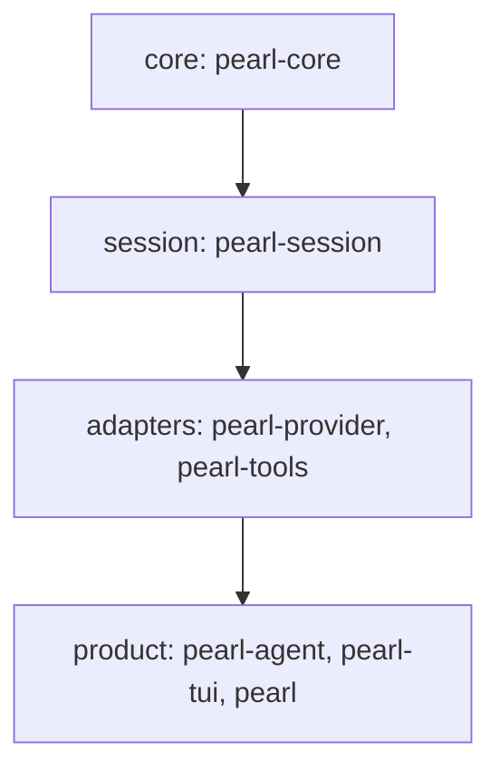

# Architecture

PEARL is a queue-centric agent development environment. The queue is the subject
the human edits; the agent loop carries each node across the wire; the session
remembers; the tools act inside a sandbox. This page names the units, the layers,
and the mechanisms.

## Units

| Crate | Layer | Responsibility |
|-------|-------|----------------|
| `pearl-core` | core | The task queue: tree data, node state machine, scheduler. The moat. |
| `pearl-session` | session | Append-only JSONL log; compaction as a projection. |
| `pearl-provider` | adapters | One provider interface over an OpenAI-compatible wire; DeepSeek first. |
| `pearl-tools` | adapters | Read, anchored revertible edit, write; the per-OS sandbox; the workspace baseline. |
| `pearl-agent` | product | The loop: dispatch, call, drain steering, persist. |
| `pearl-tui` | product | The single-focus flat view: badges for awareness, a cursor for attention. |
| `pearl` | product | The command line: shape a queue, run it, watch it flow. |

## Layers

A `use` may point only downward; `config/ci.toml` declares the order and the
`layer-order` check enforces it.

## Mechanisms

### The queue is a tree in data, a flat list in view

The data is a tree: a task has subtasks, a subtask may fan out to subagents. The
view is always a single-focus flat list at the current level — narrow to a
subtree, drill in and out. Parallelism is shown as status badges you scan;
attention is the one cursor. The human edits a flat list and navigates, never the
tree directly (ADR 11).

### The node state machine

A node is `Queued`, `Running`, `AwaitingInput`, `Paused`, `Done`, `Failed`, or
`Cancelled`. `Running` is composite: it executes, drains steering at a boundary,
and waits on its children. Two hard guarantees: steering injects at a boundary,
never mid-token; a paused node's frame and the queue are persisted outside the
model context, so "do not forget" is a system guarantee. A parent finishes only
when every child has settled.

### Steering, follow-up, preempt

- **Follow-up** appends a new node to the queue.
- **Steering** annotates a queued or running node; it drains at the turn boundary
  (ADR 10).
- **Preempt** pushes an urgent node, saving the current node's frame and pausing
  it; resume restores the frame when the urgent node settles.
- An agent confirmation is a state (`AwaitingInput`), not a new task, so it never
  swallows queued work.

### Compaction is a projection

The session keeps the full append-only log. `project(entries, keep_recent)`
renders a summary plus the retained tail for the model; the source is untouched.
The queue lives outside the model context, so no projection can drop it (ADR 7).

### Edits are anchored and revertible

`Workspace::edit` requires a unique text anchor, snapshots the file before the
first change, and `revert` restores the prior state. Paths are confined to the
root (ADR 8).

### Shell ops are revertible by baseline

Every `bash` op captures a `Baseline` of the workspace before it runs and
reports its op id; `revert_bash(op)` restores changed and deleted files and
removes created ones. The command's output is captured through a per-op file
and reaches the model, so the compiler is the feedback channel (ADR 13).

### An aside is not work

A side question (`b` on the surface, `Agent::btw` in the loop) is answered
against the session read-only and returns to the surface without entering the
queue or the log. It is a single loose node with a three-state life, held
outside the tree until dismissed (ADR 14).

### The sandbox is the OS's own primitive

`Policy` is `ReadOnly`, `WorkspaceWrite`, or `Full`. macOS uses Seatbelt
(`sandbox-exec`); Linux uses Landlock; Windows uses an AppContainer profile inside
a Job Object with kill-on-close (ADR 5). The boundary is a copy, not a cage.

The confinement is proved where it runs, not just where it compiles: four stories
spawn a real confined process and assert what it could and could not touch, and
the check suite runs them on macOS, Linux and Windows. Seatbelt matches resolved
paths, so the macOS profile names the canonical root (`/var` resolves to
`/private/var`) or a write inside the workspace would be denied.