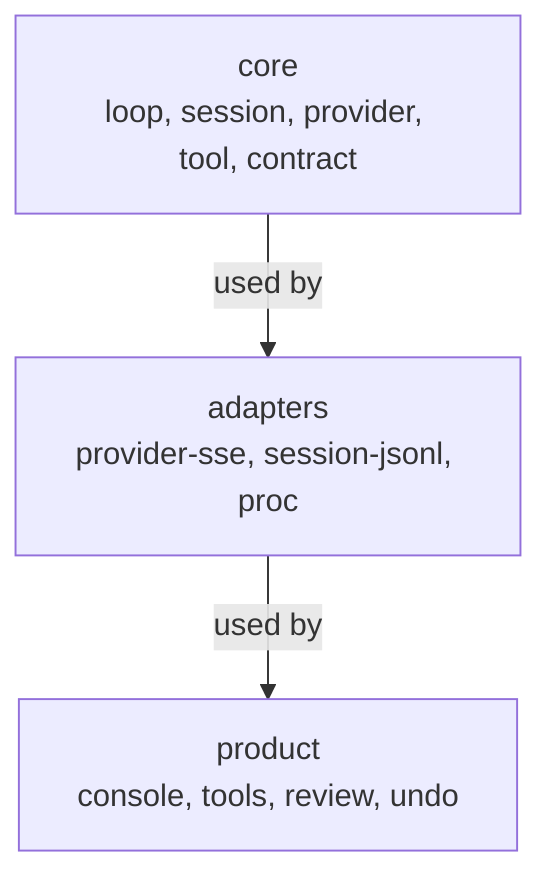
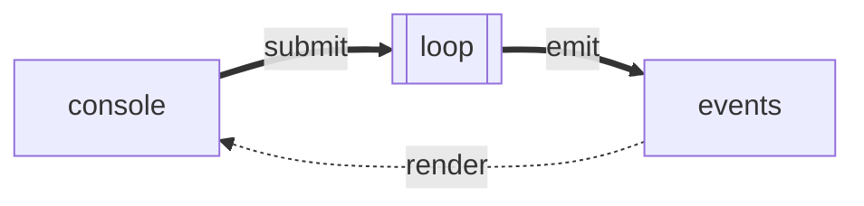
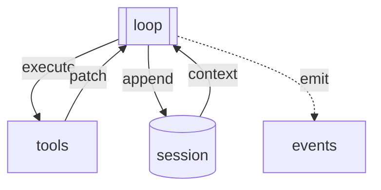

# Architecture

How the parts fit. What each choice costs is in [docs/decisions/](decisions/);
what exists today is in [roadmap.md](roadmap.md). This page is the structure:
what the units are, how they may depend on each other, how a turn flows, and
what undo guarantees.

## Units

The layer rules say what a module may depend on. This table says which modules
there are, and what each one is allowed not to know. The divisions are the
promise; whether a unit is one file or three is a refactoring.

| unit | layer | one line | may not know about |
| --- | --- | --- | --- |
| `pearl.el` | entry | autoloads only: `pearl` and the console's mode | everything else |
| `contract` | core | message, tool call, tool, event and entry, with their wire form | any IO |
| `event` | core | the event kinds and their data | who is listening |
| `loop` | core | the double loop and its two queues | buffers, files, provider names |
| `session` | core | entries, `parentId`, patches, projection, rollback plan | the storage format |
| `tool` | core | the tool shape, dispatch, and validation at the trust boundary | which tools exist |
| `provider` | core | the request interface and the fake that tests use | HTTP, SSE |
| `provider-sse` | adapter | one HTTP client, streaming, with its timeouts | the loop, the session |
| `proc` | adapter | one bounded subprocess run: deadline, output cap, diagnostics | what a command means |
| `session-jsonl` | adapter | append-only storage for entries and patches | what an entry means |
| `console` | product | the buffer, rendering, batched redraw, the status line | the loop's internals |
| `tools-read`, `tools-edit`, `tools-shell` | product | one tool each, one unit each | each other |
| `review` | product | tool output as `next-error` and `xref` entries, folded when navigable | which tools exist |
| `undo` | product | change groups and the per-turn snapshot, wired to `C-/` | the storage format |

One unit, one file: `lisp/pearl-<unit>.el`, with the package prefix the suite
requires of published modules. Tests mirror them without one:
`test/<unit>-tests.el`. Test modules are free of the prefix on purpose (a test
is not published); the `-tests` suffix keeps a module's `provide` distinct from
the one in `lisp/`.

One test module mirrors no unit: `test/pearl-support-tests.el` declares every
planned function so a story can be written before the module exists. A
declaration is dropped when the module that answers it lands; a declaration
left behind is invisible, because it only defines a function that is not
already defined.

The right-hand column is the part worth arguing about in review, because it is
the part a require rule can enforce. A unit with an empty "may not know" column
has not been placed yet.

## Layers

Three layers, told apart by **dependency direction**, not by importance. Read
the picture as "is used by":

Both arrows read "is used by", and nothing points the other way: core may not
require an adapter, an adapter may not require the product. That one rule is
what the whole table below is a consequence of.

The rule is checked rather than trusted: each module's layer is declared in
`config/ci.el`, and the suite fails a `require` that points against the arrows.
[ADR 12](decisions/0012-layer-rules-are-checked-not-documented.md) records why
the table lives there.

| | what it is for | how it is tested | replacing it means |
| --- | --- | --- | --- |
| core | a guarantee | ERT alone: no network, no buffer, no user | replacing the project |
| adapters | one job, replaceable | ERT with a fake at the other end | swapping a plugin |
| product | a usable surface | end to end | swapping a shell |

Two tests settle a placement argument:

> **Delete the module. Are the core's tests still green?**

Green means it was product or adapter. Red means it was core. Applied upstream:
delete Pi's product and its core tests still pass, so that boundary is drawn
correctly.

> **Does it need to know a file path, a buffer, or a provider's name?**

Yes is product or adapter. No, only the shape of entries and patches, is core.

One thing sits in two layers on purpose. Entries, their order and their patches
are core, because they are the guarantee the loop issues; writing them to a
file is an adapter, because that is a storage decision. Split that way, "session
in the core" does not mean "IO in the core".

## The two rings

Two pictures, because there are two loops and one picture of both became a
spiral.

**Control ring**: who is watching the agent work.

**Memory ring**: what changed, what was recorded, what is read next time.

An architecture picture of an agent with no ring in it is almost always wrong,
because the job is exactly "look, change, record, look again".

The memory ring is also where PEARL differs most from Pi, and the difference is
invisible in an arrow. Pi's loop emits `events` and never reads a session: the
product subscribes, appends, and replays the branch into the next request, so
the ring leaves the core and comes back through a layer above it. Here the
session is in the core, so the ring closes inside one layer — and a guarantee no
layer above can forget is not a convention.

## Undo

Undo is layered, and the layers are used in this order:

| layer | mechanism | lives in | survives |
| --- | --- | --- | --- |
| one tool call | an Emacs change group, amalgamated into one `undo` step | `undo`, called by the edit tool | until the buffer is killed |
| one turn, on disk | a tree snapshot taken when the turn starts | `undo`, attached to the loop's events | a restart |
| one entry, durable | the patch the entry carries | the core | a restart, and a second consumer |

The snapshot is product work, so the loop cannot take it: `pearl-undo-attach`
subscribes to `turn-start` and `turn-end` on the event stream, and the console
wires that in when it builds the loop. The direction is the layer rule doing
its job — undo may require core, core may not require undo.

The first layer is why there is no undo command to learn: `C-/` already means
what it should mean. The second is what makes a change revertible after Emacs
has forgotten the buffer. The third is what a second consumer of the runtime
would read, and it is built when something needs it.

Three rules follow:

**1. Only entries that changed something outside the session carry a patch.**
Conversational entries carry none. If every entry had to carry one, rollback
would start depending on the assumption that an empty patch is harmless.

**2. Rollback is path-scoped, never entry-scoped.** "Undo this step" means
"undo the last write on the active path". Otherwise a parallel branch forces
the question "does that patch still apply here", which has no good answer.

**3. A restore that cannot verify its baseline refuses.** Every patch is checked
against the file before it is applied. A conflict is reported by name, not
guessed at, because a wrong restore is worse than a refused one.

What this does not cover is in [ADR 5](decisions/0005-safety-revertible-edits-confirmed-commands.md):
commands, their side effects, and why the answer is confirmation rather than a
sandbox.

## The event loop

The loop is asynchronous at every point where it waits: for a model reply, for
a tool, for the next turn's preparation. Emacs has no promises, so each of
those points is a callback, and the callbacks arrive from process sentinels. A
sentinel runs inside the event loop, where work blocks timers, input and
redisplay alike.

Three rules follow, and they are the reason the console never freezes without
looking like a bug:

1. **Heavy work is re-dispatched, never run in a sentinel.** A step reached
   from a callback is scheduled on a zero-delay timer, so it runs in ordinary
   command-loop context. The chain stays serialized: each step's callback is
   what schedules the next.
2. **A run carries a generation counter.** It is captured when the run starts
   and compared before every dispatch; a mismatch means the run was aborted,
   and the chain stops through the terminal callback so a caller's busy flag
   is always released.
3. **A dead buffer is an error, not a silence.** If the buffer a run belongs to
   was killed, the run reports it rather than dropping the chain.

One consequence shapes the modules: session state is an explicit object passed
into the loop, not a buffer-local variable. The core reads the session back
through the projection, and a variable attached to a buffer cannot be read from
the core. [ADR 10](decisions/0010-deferred-work-runs-on-timers-not-in-sentinels.md)
records the decision, and [ADR 3](decisions/0003-why-the-session-lives-in-the-core.md)
records what makes it necessary.

## Compaction

Compaction belongs to the read side: it replaces what the model reads with a
summary, and the tree keeps every node. It is the one deferred feature whose
seam already exists — it hangs off the projection that builds
[context](glossary.md#context) — and adding it must not touch entries or
patches.

## Related

- [docs/decisions/](decisions/) — one record per difference, each with its price
- [glossary.md](glossary.md) — one word, one meaning
- [roadmap.md](roadmap.md) — what exists today
