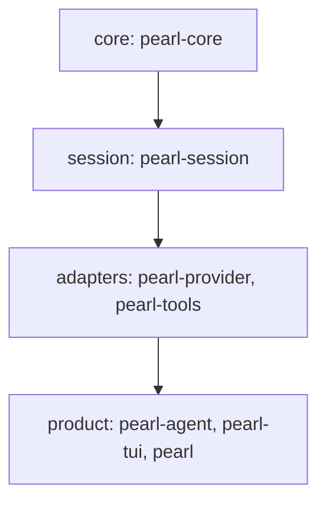

# Architecture

PEARL is a queue-centric agent development environment. The queue is the subject
the human edits; the agent loop carries each node across the wire; the session
remembers; the tools act inside a sandbox. This page names the units, the layers,
and the mechanisms.

## Units

| Crate | Layer | Responsibility |
|-------|-------|----------------|
| `pearl-core` | core | The task queue: tree data, node state machine, scheduler. The moat. |
| `pearl-session` | session | Append-only JSONL log; compaction as a projection. |
| `pearl-provider` | adapters | One provider interface over an OpenAI-compatible wire; DeepSeek first. |
| `pearl-tools` | adapters | Read, anchored revertible edit, write; the per-OS sandbox; the workspace baseline and the copy a fan-out gives each child. |
| `pearl-agent` | product | The loop: dispatch, call, drain steering, persist. |
| `pearl-tui` | product | The single-focus flat view: badges for awareness, a cursor for attention, the focused task's report below it, naming the act while it runs. |
| `pearl` | product | The command line: shape a queue, run it, watch it flow. |

## Layers

A `use` may point only downward; `config/ci.toml` declares the order and the
`layer-order` check enforces it.

## Mechanisms

### The queue is a tree in data, a flat list in view

The data is a tree: a task has subtasks, a subtask may fan out to subagents. The
view is always a single-focus flat list at the current level — narrow to a
subtree, drill in and out. Parallelism is shown as status badges you scan;
attention is the one cursor. The human edits a flat list and navigates, never the
tree directly (ADR 11).

Below the list is the report of the focused task: its reply, or its failure
reason, or — while it runs — the act it is on, or `no report yet` if it has not
started. The loop calls `queue.note(id, act)` before it asks the model and before
each tool call, naming the tool and the path or command it touches; a note is
presentation, so a node that has been cancelled refuses it and the work goes on. The list takes the rows its tasks need up to half the
surface and the report takes the rest, showing the tail so the newest line is the
one in front of the eye. Reading is not a mode you enter — the queue is what the
attention rests on while the agent generates, and the report is what it reads
while shaping the next task.

### The node state machine

A node is `Queued`, `Running`, `AwaitingInput`, `Paused`, `Done`, `Failed`, or
`Cancelled`. `Running` is composite: it executes, drains steering at a boundary,
and waits on its children. Two hard guarantees: steering injects at a boundary,
never mid-token; a paused node's frame and the queue are persisted outside the
model context, so "do not forget" is a system guarantee. A parent finishes only
when every child has settled.

### Editing the queue: take and place

An unexecuted node is not edited in place. It is **taken** into the hand as a
`Request` (`take(id)`), the human edits that value, and **places** it back
(`place(request, position)`). One model covers append, insert, reorder, and
redirect: a `Request` is a task not yet placed, carrying a `Form` (`Task` or
`Steering`) and an optional target; a `Position` says where it lands — `After`
the focus, `Now` before everything, or `Into(id)` as a steering hint. There is no
separate draft type; the request is the disassembled node. The hand holds one
request at a time, so attention stays single-thread (ADR 11).

### The runtime operations

- **Follow-up** appends a new node; **steering** annotates a queued or running
  node and drains at the turn boundary (ADR 10).
- **Preempt** pushes an urgent node, saving the running node's frame and pausing
  it. **Hold** pauses without an urgent successor; **resume** restores the frame.
- **Redirect** retitles a queued node; **cancel** ends one; **retry** requeues a
  failed one.
- An agent confirmation is a state (`AwaitingInput`), not a new task, so it never
  swallows queued work.

### One queue, two holders

The surface and the runner are the same session. `Queue` is a handle over one
tree behind a mutex, so the surface edits what the runner drains and neither
holds a copy (ADR 17). `Agent::serve(stop)` runs what is placed and waits on a
`watch` channel when nothing is, so an empty queue is a state and not the end of
the process. A provider that refuses fails the node, not the session: the queue's
other work still runs, and the failed badge is what the human retries.

### Subagents are derived sessions

A node fans out with `spawn`: each child gets a derived session
(`parent-{child}.jsonl`) and its own copy of the workspace under
`children/<child>/`, and `run_children` runs them at the same time (ADR 15). A
child settles as a queue event, and the parent finishes only when every child has
settled — the nesting invariant. The human keeps one focus while the children
run. Because each child writes into its own copy, one child's revert cannot
reach another's tree, and no scheduling rule has to be trusted to keep them
apart. What a child produces returns as text; merging its tree back into the
parent's is a later promise.

### Compaction is a projection

The session keeps the full append-only log. `view(entries)` hides what a later
summary covers; `split` chooses the cut — the largest tail the budget leaves,
never below three entries, snapped forward to a `User` turn so a tool result is
never separated from the call it answers; `project` asks the model to write the
summary and returns it with the range to record. The loop folds at three
quarters of the window, appends the summary with its coverage (ADR 16), and
learns its estimator from each completion's billed `prompt_tokens`. The source
is untouched, and the queue lives outside the model context, so no projection
can drop it (ADR 7).

### Edits are anchored and revertible

`Workspace::edit` requires a unique text anchor, snapshots the file before the
first change, and `revert` restores the prior state. Paths are confined to the
root (ADR 8).

### Shell ops are revertible by baseline

Every `bash` op captures a `Baseline` of the workspace before it runs and
reports its op id; `revert_bash(op)` restores changed and deleted files and
removes created ones. The command's output is captured through a per-op file
and reaches the model, so the compiler is the feedback channel (ADR 13).

### An aside is not work

A side question (`b` on the surface, `Agent::btw` in the loop) is answered
against the session read-only and returns to the surface without entering the
queue or the log. It is a single loose node with a three-state life, held
outside the tree until dismissed (ADR 14).

### The sandbox is the OS's own primitive

`Policy` is `ReadOnly`, `WorkspaceWrite`, or `Full`. macOS uses Seatbelt
(`sandbox-exec`); Linux uses Landlock; Windows uses an AppContainer profile inside
a Job Object with kill-on-close (ADR 5). The boundary is a copy, not a cage.

The confinement is proved where it runs, not just where it compiles: four stories
spawn a real confined process and assert what it could and could not touch, and
the check suite runs them on macOS, Linux and Windows. Seatbelt matches resolved
paths, so the macOS profile names the canonical root (`/var` resolves to
`/private/var`) or a write inside the workspace would be denied.