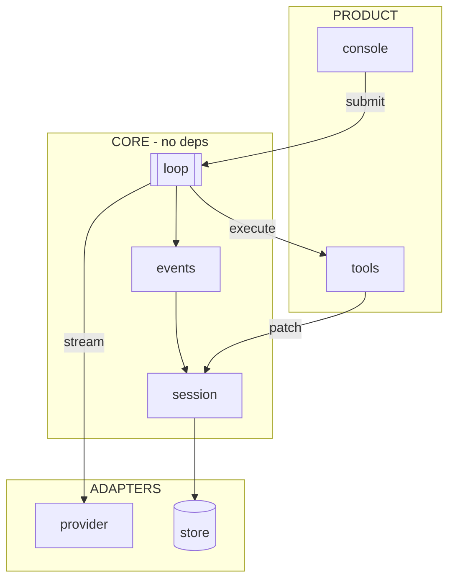

# Layers

Three layers, told apart by **dependency direction**, not by importance. A
module is in the core because of what it may not depend on, not because it
matters more.

| | Core | Adapters | Product |
| --- | --- | --- | --- |
| May depend on | Emacs built-ins and its own data | core | core and adapters |
| Exists to provide | a guarantee | one job, replaceable | a usable surface |
| Tested by | ERT alone, no network, no buffer, no user | ERT with a fake at the other end | end to end |
| Replacing it means | replacing the project | swapping a plugin | swapping a shell |

The diagram is a DAG on purpose: the console reads the event stream, and that
back edge is written into the `console` node instead of the graph, because a
cycle that crosses a subgraph boundary breaks the ASCII renderer used to check
these documents. See [architecture.md#drawing-rules](architecture.md#drawing-rules).

## The test that decides

> Delete the module. Are the core's tests still green?

- Still green: it was product or adapter.
- Red: it was core.

Applied upstream: delete `packages/coding-agent` from Pi and `agent-core`'s
tests still pass, so that boundary is drawn correctly. Delete `agent-core` and
the product stops existing.

## Why the session split is not a compromise

Session straddles two layers, and that is the point:

| Half | Layer | Why |
| --- | --- | --- |
| entry order, `parentId`, patches, rollback atomicity | core | it is the guarantee the loop issues |
| writing entries to a file, a database, a durable object | adapter | a storage decision, not a semantic one |

The core owns a data shape and its operations. An adapter owns a format. Split
that way, "session in the core" does not mean "IO in the core".

## The daily test

> Does it need to know a file path, a buffer, or a provider's name?

- Yes: product or adapter.
- No, only the shape of entries and patches: core.

| Module | Layer | Because |
| --- | --- | --- |
| `pearl-loop` | core | knows how to send a request and run a tool, nothing else |
| `pearl-session` | core | entries and patches only |
| `pearl-session-jsonl` | adapter | needs a path |
| `pearl-provider-sse` | adapter | needs a URL and HTTP |
| `pearl-console` | product | needs a buffer |
| `pearl-tool-edit` | product | needs a buffer and a locator |

## Making it a rule instead of a habit

The check suite already has a direction check for module classes. The stronger
version, worth adding when the core modules exist:

> `pearl-loop`, `pearl-session` and `pearl-event` may not `require` any
> `pearl-provider-*`, `pearl-console-*` or `pearl-tool-*`.

With that in place the core cannot quietly grow into a small coding agent.

## Related

- [architecture.md](architecture.md) — how the layers communicate
- [differences.md#3-why-the-session-lives-in-the-core](differences.md#3-why-the-session-lives-in-the-core)
- [glossary.md#session](glossary.md#session)
